<p align="center">
  <a href="https://korczis.github.io/algoglyph/">
    <picture>
      <source media="(prefers-color-scheme: light)" srcset="docs/previews/gallery-light.jpg">
      
    </picture>
  </a>
</p>

<h1 align="center">algoglyph</h1>

<p align="center">
  Algorithms and physics drawn as glyphs: seeded, interactive p5.js simulations whose every
  number is measured from the running state.
</p>

<p align="center">
  <a href="https://korczis.github.io/algoglyph/"><b>Live site</b></a> ·
  <a href="#plates">Plates</a> ·
  <a href="#how-it-works">How it works</a> ·
  <a href="#development">Development</a>
</p>

<p align="center">
  <a href="https://github.com/korczis/algoglyph/actions/workflows/pages.yml"></a>
  <a href="LICENSE"></a>
</p>

<!-- algoglyph:derived:begin counts -->
<!-- Generated by scripts/build-readme.mjs from catalogue/. Do not edit by hand: run `npm run readme`. -->
<p align="center"><b>254 live plates</b> and 0 planned, 21 comparison labs, in 12 wings:<br><sub>Foundations 18/18 · Sorting and selection 27/27 · Searching and symbol tables 25/25 · Strings and text 28/28 · Geometry and space 20/20 · Graphs and networks 42/42 · Numbers and computation 21/21 · Signals and sound 14/14 · Dynamics and complexity 14/14 · Physics 9/9 · Evidence and decisions 19/19 · Distributed systems 17/17</sub></p>
<!-- algoglyph:derived:end counts -->

## What it is

A gallery of plates. Each plate is one algorithm or physical system running live in the
browser, 2D or 3D, with its parameters exposed as controls and its state reported as readouts:
comparisons and writes for a sort, frontier size for a search, energy drift for an integrator.
The pictures are what the code actually does, so they can be read as well as looked at.

It is a static site (Vite, TypeScript, p5.js 2 in instance mode, Alpine.js, a Flowbite Pro
shell on Tailwind 4). There is no server and nothing is loaded from a CDN.

Open a plate, change a parameter, press `R` to reseed; the address bar now names that exact
picture and anyone opening it sees the same one.

Keyboard: Space play/pause, `.` step, `R` reseed, `D` defaults, `S` PNG, `F` full screen,
arrows previous/next, `G` collection, `T` theme, `/` search.

## Plates

The catalogue, one Markdown file per algorithm under `catalogue/entries/`, is the only
description of the collection: its taxonomy (`catalogue/taxonomy.yaml`) orders the wings and
shelves below and numbers the plates. Live plates show their preview; planned ones are listed
under each wing. Each title opens the entry on the live site.

<!-- algoglyph:derived:begin catalogue -->
<!-- Generated by scripts/build-readme.mjs from catalogue/. Do not edit by hand: run `npm run readme`. -->

### Foundations

<sub>The building blocks every other plate stands on — connectivity, recursion, lists, stacks and the arithmetic of cost. 18 live plates, 0 planned.</sub>

<table>
<tr>
<td width="50%" valign="top">
<b><a href="https://korczis.github.io/algoglyph/#/p/quick-find">001 · Quick-find</a></b><br>
Every object carries its component id, so a find is one look-up and a union rewrites every member of one side.<br>
<sub>Union-find · one array access per find, n per union: quadratic for n unions · union-find, connectivity</sub>
</td>
<td width="50%" valign="top">
<b><a href="https://korczis.github.io/algoglyph/#/p/quick-union">002 · Quick-union</a></b><br>
Each object points to a parent; a union links one root under the other and a find climbs to the root.<br>
<sub>Union-find · proportional to the tree height per find, n in the worst case · union-find, forest</sub>
</td>
</tr>
<tr>
<td width="50%" valign="top">
<b><a href="https://korczis.github.io/algoglyph/#/p/weighted-quick-union">003 · Weighted quick-union</a></b><br>
Link the smaller tree under the larger, so no tree grows taller than lg n.<br>
<sub>Union-find · at most lg n links per find · union-find, balanced</sub>
</td>
<td width="50%" valign="top">
<b><a href="https://korczis.github.io/algoglyph/#/p/path-compression">004 · Weighted quick-union with path compression</a></b><br>
Point every node a find passes straight at the root, making each operation almost constant time.<br>
<sub>Union-find · O(m α(n)) array accesses for m operations · union-find, amortised</sub>
</td>
</tr>
<tr>
<td width="50%" valign="top">
<b><a href="https://korczis.github.io/algoglyph/#/p/circular-queue">005 · FIFO queue in a ring buffer</a></b><br>
A first-in first-out queue whose head and tail chase each other around a fixed array.<br>
<sub>Elementary structures · O(1) per enqueue and dequeue, O(capacity) space · queue, ring buffer</sub>
<br><sub>Pointer: Click to enqueue an item by hand.</sub>
</td>
<td width="50%" valign="top">
<b><a href="https://korczis.github.io/algoglyph/#/p/infix-to-postfix">006 · Infix to postfix conversion</a></b><br>
Convert an infix expression to postfix with an operator stack.<br>
<sub>Elementary structures · O(n) for n tokens: each operator is pushed and popped once · stack, expressions, parsing</sub>
</td>
</tr>
<tr>
<td width="50%" valign="top">
<b><a href="https://korczis.github.io/algoglyph/#/p/josephus-circle">007 · Josephus problem</a></b><br>
People in a circle, every M-th one leaves, on a circular linked list until one is left.<br>
<sub>Elementary structures · (N − 1)(M − 1) link steps and N − 1 removals · linked list, circular</sub>
</td>
<td width="50%" valign="top">
<b><a href="https://korczis.github.io/algoglyph/#/p/postfix-evaluation">008 · Postfix evaluation with a stack</a></b><br>
Read an expression in postfix notation and evaluate it with one pushdown stack.<br>
<sub>Elementary structures · O(n) for n tokens, one push or two pops and a push per token · stack, expressions</sub>
</td>
</tr>
<tr>
<td width="50%" valign="top">
<b><a href="https://korczis.github.io/algoglyph/#/p/ruler-drawing">009 · Drawing a ruler recursively</a></b><br>
Mark the middle, then each half, recursively: the ticks of a ruler are the call tree.<br>
<sub>Recursion and divide and conquer · 2ⁿ − 1 marks; the recursive versions make 2ⁿ⁺¹ − 1 calls at depth at most n · recursion, divide and conquer</sub>
</td>
<td width="50%" valign="top">
<b><a href="https://korczis.github.io/algoglyph/#/p/towers-of-hanoi">010 · Towers of Hanoi</a></b><br>
Move n discs by moving n − 1 aside, the largest once, and the n − 1 back: 2ⁿ − 1 moves.<br>
<sub>Recursion and divide and conquer · 2ⁿ − 1 moves, recursion depth n · recursion, divide and conquer</sub>
</td>
</tr>
<tr>
<td width="50%" valign="top">
<b><a href="https://korczis.github.io/algoglyph/#/p/tree-traversal">011 · Tree traversal orders</a></b><br>
Preorder, inorder, postorder and level order visiting the same tree.<br>
<sub>Recursion and divide and conquer · linear: each order visits every node once · trees, preorder, inorder, postorder, level order</sub>
</td>
<td width="50%" valign="top">
<b><a href="https://korczis.github.io/algoglyph/#/p/fibonacci-memo">012 · Fibonacci, recursion versus memoisation</a></b><br>
The naive recursion's exponential call tree next to the linear table that remembers it.<br>
<sub>Dynamic programming · exponential calls naive (about φ^n), linear calls memoised · dynamic programming, memoisation, recursion</sub>
</td>
</tr>
<tr>
<td width="50%" valign="top">
<b><a href="https://korczis.github.io/algoglyph/#/p/knapsack-dp">013 · Knapsack by dynamic programming</a></b><br>
Fill a capacity table item by item; the best value for each capacity reuses smaller ones.<br>
<sub>Dynamic programming · Θ(nW) time and space for n items and capacity W (pseudo-polynomial) · dynamic programming, knapsack</sub>
</td>
<td width="50%" valign="top">
<b><a href="https://korczis.github.io/algoglyph/#/p/longest-common-subsequence">014 · Longest common subsequence</a></b><br>
The longest sequence both strings contain in order, read back from a filled table.<br>
<sub>Dynamic programming · Θ(mn) time and space for strings of lengths m and n · dynamic programming, strings, alignment</sub>
</td>
</tr>
<tr>
<td width="50%" valign="top">
<b><a href="https://korczis.github.io/algoglyph/#/p/matrix-chain">015 · Matrix-chain multiplication order</a></b><br>
The cheapest order to multiply a chain of matrices, from the costs of every shorter chain.<br>
<sub>Dynamic programming · Θ(n³) time, Θ(n²) space · dynamic programming, parenthesisation</sub>
</td>
<td width="50%" valign="top">
<b><a href="https://korczis.github.io/algoglyph/#/p/optimal-bst">016 · Optimal binary search tree</a></b><br>
The search tree with least expected cost for known access frequencies, built from subtrees.<br>
<sub>Dynamic programming · Θ(n³) time, Θ(n²) space (Knuth's monotone-root bound gives Θ(n²)) · dynamic programming, search trees</sub>
</td>
</tr>
<tr>
<td width="50%" valign="top">
<b><a href="https://korczis.github.io/algoglyph/#/p/n-queens">017 · Eight queens by backtracking</a></b><br>
Place queens row by row, back up the moment one is attacked, and count the dead ends.<br>
<sub>Exhaustive search · exponential in n; the 8 x 8 board has 92 solutions · backtracking, constraint search</sub>
</td>
<td width="50%" valign="top">
<b><a href="https://korczis.github.io/algoglyph/#/p/permutation-generation">018 · Permutation generation</a></b><br>
Every permutation of n items, each from the last by one exchange.<br>
<sub>Exhaustive search · n! permutations, one exchange each; amortised O(1) work per step for Heap's method, O(n) for Johnson–Trotter as written · exhaustive search, permutations</sub>
</td>
</tr>
</table>

### Sorting and selection

<sub>Putting things in order, and what each method costs in comparisons, moves and memory. 27 live plates, 0 planned.</sub>

<table>
<tr>
<td width="50%" valign="top">
<a href="https://korczis.github.io/algoglyph/#/p/sort-tapestry"><picture><source media="(prefers-color-scheme: light)" srcset="docs/previews/sort-tapestry-light.jpg">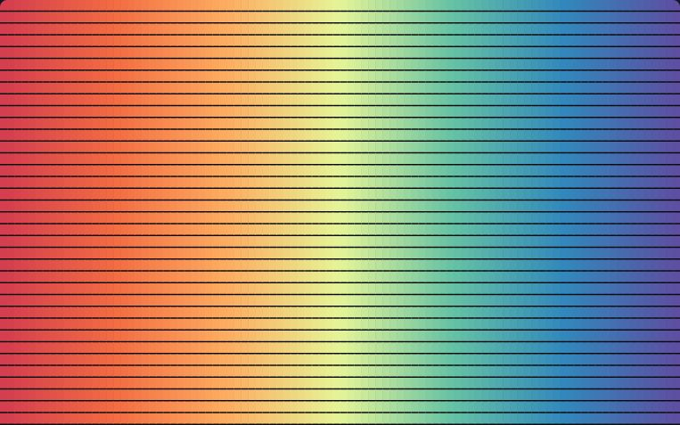</picture></a><br>
<b><a href="https://korczis.github.io/algoglyph/#/p/sort-tapestry">019 · Sort Tapestry</a></b><br>
Every row is its own shuffled spectrum, sorted in lockstep by one algorithm: its fingerprint is woven into the cloth.<br>
<sub>Overviews · see the algorithm · sorting, generators, permutations</sub>
</td>
<td width="50%" valign="top">
<b><a href="https://korczis.github.io/algoglyph/#/p/binary-insertion-sort">020 · Binary insertion sort</a></b><br>
Insertion sort that finds each insertion point by binary search.<br>
<sub>Elementary sorts · n lg n compares, n²/4 moves · sorting, quadratic, stable, binary search</sub>
</td>
</tr>
<tr>
<td width="50%" valign="top">
<b><a href="https://korczis.github.io/algoglyph/#/p/bubble-sort">021 · Bubble sort</a></b><br>
Exchange neighbours that are out of order, pass after pass, until a pass changes nothing.<br>
<sub>Elementary sorts · n²/2 compares worst case · sorting, quadratic, stable, in-place</sub>
</td>
<td width="50%" valign="top">
<b><a href="https://korczis.github.io/algoglyph/#/p/shaker-sort">022 · Cocktail shaker sort</a></b><br>
Bubble sort that alternates direction, so small keys travel left as fast as large keys travel right.<br>
<sub>Elementary sorts · n²/2 compares worst case · sorting, quadratic, stable, bidirectional</sub>
</td>
</tr>
<tr>
<td width="50%" valign="top">
<b><a href="https://korczis.github.io/algoglyph/#/p/insertion-sort">023 · Insertion sort</a></b><br>
Take each key in turn and slide it left into the sorted prefix.<br>
<sub>Elementary sorts · about n²/4 compares on random keys, n on sorted · sorting, quadratic, stable, adaptive, in-place</sub>
</td>
<td width="50%" valign="top">
<b><a href="https://korczis.github.io/algoglyph/#/p/selection-sort">024 · Selection sort</a></b><br>
Find the smallest remaining key and exchange it into place, left to right.<br>
<sub>Elementary sorts · n²/2 compares, n − 1 exchanges · sorting, quadratic, in-place</sub>
</td>
</tr>
<tr>
<td width="50%" valign="top">
<b><a href="https://korczis.github.io/algoglyph/#/p/shellsort-knuth">025 · Shellsort, 3h + 1 increments</a></b><br>
Insertion sort on keys h apart, for h = …, 40, 13, 4, 1: Knuth's increments.<br>
<sub>Elementary sorts · O(n^(3/2)) worst case for this sequence · sorting, shellsort, in-place, increments</sub>
</td>
<td width="50%" valign="top">
<b><a href="https://korczis.github.io/algoglyph/#/p/shellsort-sedgewick">026 · Shellsort, Sedgewick increments</a></b><br>
Shellsort with the increments 1, 8, 23, 77, 281, … = 4^k + 3·2^(k−1) + 1.<br>
<sub>Elementary sorts · O(n^(4/3)) worst case · sorting, shellsort, in-place, increments</sub>
</td>
</tr>
<tr>
<td width="50%" valign="top">
<b><a href="https://korczis.github.io/algoglyph/#/p/quicksort">027 · Quicksort</a></b><br>
Partition around the rightmost key, then sort the two sides.<br>
<sub>Quicksort · 1.39 n lg n compares on average, n²/2 worst case · sorting, quicksort, partitioning, divide and conquer, in-place</sub>
</td>
<td width="50%" valign="top">
<b><a href="https://korczis.github.io/algoglyph/#/p/quicksort-median-of-three">028 · Quicksort, median-of-three with cutoff</a></b><br>
The pivot is the median of the first, middle and last keys; small subfiles are left for one final insertion sort.<br>
<sub>Quicksort · about 1.19 n lg n compares on average · sorting, quicksort, median of three, insertion cutoff</sub>
</td>
</tr>
<tr>
<td width="50%" valign="top">
<b><a href="https://korczis.github.io/algoglyph/#/p/quicksort-three-way">029 · Quicksort, three-way partitioning</a></b><br>
Dijkstra's three-way partition into keys less than, equal to and greater than the pivot.<br>
<sub>Quicksort · linear when the number of distinct keys is constant · sorting, quicksort, duplicate keys, dutch national flag</sub>
</td>
<td width="50%" valign="top">
<b><a href="https://korczis.github.io/algoglyph/#/p/mergesort-bottom-up">030 · Mergesort, bottom-up</a></b><br>
Merge runs of 1, then 2, 4, 8 and so on across the whole array, without recursion.<br>
<sub>Mergesort · at most n lg n compares, n extra space · sorting, mergesort, stable, iterative, auxiliary memory</sub>
</td>
</tr>
<tr>
<td width="50%" valign="top">
<b><a href="https://korczis.github.io/algoglyph/#/p/mergesort-top-down">031 · Mergesort, top-down</a></b><br>
Sort each half recursively, then merge the two sorted halves.<br>
<sub>Mergesort · at most n lg n compares, n extra space · sorting, mergesort, stable, divide and conquer, auxiliary memory</sub>
</td>
<td width="50%" valign="top">
<b><a href="https://korczis.github.io/algoglyph/#/p/mergesort-natural">032 · Natural mergesort</a></b><br>
Find the ascending runs the input already has, and merge neighbouring runs until one is left.<br>
<sub>Mergesort · linear on sorted input, n lg n at worst · sorting, mergesort, stable, adaptive, runs</sub>
</td>
</tr>
<tr>
<td width="50%" valign="top">
<b><a href="https://korczis.github.io/algoglyph/#/p/binary-heap">033 · Binary heap priority queue</a></b><br>
Insert sifts a key up, remove-max sinks the replacement down, in a complete binary tree.<br>
<sub>Priority queues and heapsort · at most lg n compares per insert and 2 lg n per remove-max · heap, priority queue, sift up, sift down</sub>
</td>
<td width="50%" valign="top">
<b><a href="https://korczis.github.io/algoglyph/#/p/binomial-queue">034 · Binomial queue</a></b><br>
A forest of power-of-two trees that merges like binary addition.<br>
<sub>Priority queues and heapsort · lg n per insert, remove-max and join · priority queue, binomial trees, mergeable</sub>
</td>
</tr>
<tr>
<td width="50%" valign="top">
<b><a href="https://korczis.github.io/algoglyph/#/p/heapsort">035 · Heapsort</a></b><br>
Build a max-heap bottom-up, then repeatedly exchange the maximum to the end and restore the heap.<br>
<sub>Priority queues and heapsort · 2 n lg n compares worst case, in place · sorting, heap, priority queue, in-place</sub>
</td>
<td width="50%" valign="top">
<b><a href="https://korczis.github.io/algoglyph/#/p/binary-quicksort">036 · Binary quicksort</a></b><br>
Radix exchange: partition on the leading bit, then recurse on the next bit.<br>
<sub>Radix sorts · about n lg n bit examinations · sorting, radix exchange, bits, non-comparison, in-place</sub>
</td>
</tr>
<tr>
<td width="50%" valign="top">
<b><a href="https://korczis.github.io/algoglyph/#/p/counting-sort">037 · Key-indexed counting</a></b><br>
Count every key, turn the counts into start positions, and distribute the keys into the auxiliary array.<br>
<sub>Radix sorts · n + R operations for keys in 0..R−1 · sorting, counting, stable, non-comparison</sub>
</td>
<td width="50%" valign="top">
<b><a href="https://korczis.github.io/algoglyph/#/p/lsd-radix-sort">038 · LSD radix sort</a></b><br>
Sort by the least significant base-4 digit first, with one stable counting pass per digit.<br>
<sub>Radix sorts · W passes of key-indexed counting for W digits · sorting, radix, stable, non-comparison, digits</sub>
</td>
</tr>
<tr>
<td width="50%" valign="top">
<b><a href="https://korczis.github.io/algoglyph/#/p/msd-radix-sort">039 · MSD radix sort</a></b><br>
Distribute by the leading base-4 digit, then sort each bin on the next digit, recursively.<br>
<sub>Radix sorts · about n log_R n digit examinations · sorting, radix, non-comparison, digits, recursive</sub>
</td>
<td width="50%" valign="top">
<b><a href="https://korczis.github.io/algoglyph/#/p/three-way-radix-quicksort">040 · Three-way radix quicksort</a></b><br>
Partition strings into less, equal and greater on one character, then recurse on the next.<br>
<sub>Radix sorts · about 2 n ln n character comparisons for random strings; linear in the characters examined for long shared prefixes · sorting, strings, radix, partitioning</sub>
</td>
</tr>
<tr>
<td width="50%" valign="top">
<b><a href="https://korczis.github.io/algoglyph/#/p/balanced-multiway-merge">041 · Balanced multiway merge</a></b><br>
Sort runs that fit in memory, distribute them over tapes, and merge them in passes.<br>
<sub>Sorting networks and external sorts · ⌈log_P ⌈N/M⌉⌉ merge passes, each reading and writing every record once with O(log P) comparisons per record · external sorting, merging, tapes</sub>
</td>
<td width="50%" valign="top">
<b><a href="https://korczis.github.io/algoglyph/#/p/batcher-merge-exchange">042 · Batcher's merge exchange</a></b><br>
Batcher's odd-even merge exchange: a fixed schedule of compare-exchanges that sorts any input.<br>
<sub>Sorting networks and external sorts · O(n log² n) compare-exchanges, fixed in advance · sorting, sorting network, parallel, oblivious</sub>
</td>
</tr>
<tr>
<td width="50%" valign="top">
<b><a href="https://korczis.github.io/algoglyph/#/p/perfect-shuffle-merge">043 · Merging with perfect shuffles</a></b><br>
Batcher's merge expressed as perfect shuffles and compare-exchanges, as a parallel machine would run it.<br>
<sub>Sorting networks and external sorts · O(n log² n) compare-exchanges, fixed in advance · sorting network, parallel, shuffle, oblivious</sub>
</td>
<td width="50%" valign="top">
<b><a href="https://korczis.github.io/algoglyph/#/p/replacement-selection">044 · Replacement selection</a></b><br>
A priority queue that produces initial runs about twice the size of memory.<br>
<sub>Sorting networks and external sorts · lg M compares per key; runs of expected length 2M on random input · external sorting, priority queue, runs</sub>
</td>
</tr>
<tr>
<td width="50%" valign="top">
<b><a href="https://korczis.github.io/algoglyph/#/p/quickselect">045 · Quickselect</a></b><br>
Partition, then continue only in the side that holds rank k.<br>
<sub>Selection · linear on average · selection, partitioning, k-th smallest, linear time</sub>
</td>
<td width="50%"></td>
</tr>
</table>

### Searching and symbol tables

<sub>Finding a key among many, and the structures that make it fast. 25 live plates, 0 planned.</sub>

<table>
<tr>
<td width="50%" valign="top">
<b><a href="https://korczis.github.io/algoglyph/#/p/binary-search">046 · Binary search</a></b><br>
Halve the sorted interval that can hold the key, lg n times at most.<br>
<sub>Elementary search · at most ⌊lg n⌋ + 1 probes · search, sorted array, divide and conquer</sub>
</td>
<td width="50%" valign="top">
<b><a href="https://korczis.github.io/algoglyph/#/p/interpolation-search">047 · Interpolation search</a></b><br>
Guess where the key should be from its value, not the middle: lg lg n on uniform keys.<br>
<sub>Elementary search · about lg lg n probes on uniformly spread keys, O(n) in the worst case · search, sorted array, interpolation</sub>
</td>
</tr>
<tr>
<td width="50%" valign="top">
<b><a href="https://korczis.github.io/algoglyph/#/p/sequential-search">048 · Sequential search</a></b><br>
Look at every key until the one wanted turns up, or the list ends.<br>
<sub>Elementary search · O(n) per search; a hit costs its position, a miss the whole list · search, symbol table</sub>
</td>
<td width="50%" valign="top">
<b><a href="https://korczis.github.io/algoglyph/#/p/bst-search-insert">049 · Binary search tree</a></b><br>
Search and insert by comparing down from the root; the shape is the insertion order.<br>
<sub>Binary search trees · about 1.39 lg n compares per search on random keys, n in the worst case · binary search tree, symbol table</sub>
</td>
</tr>
<tr>
<td width="50%" valign="top">
<b><a href="https://korczis.github.io/algoglyph/#/p/bst-delete-join">050 · Deletion and join in a binary search tree</a></b><br>
Delete a key by joining its two subtrees, and see what repeated deletion does to the shape.<br>
<sub>Binary search trees · proportional to the height of the tree per operation · binary search tree, deletion</sub>
</td>
<td width="50%" valign="top">
<b><a href="https://korczis.github.io/algoglyph/#/p/bst-root-insertion">051 · Insertion at the root</a></b><br>
Insert at the bottom, then rotate the new key up to the root.<br>
<sub>Binary search trees · the comparisons of a plain insertion plus one rotation per level climbed · binary search tree, rotations</sub>
</td>
</tr>
<tr>
<td width="50%" valign="top">
<b><a href="https://korczis.github.io/algoglyph/#/p/bst-rotations">052 · Rotations in a binary search tree</a></b><br>
A rotation exchanges a parent and child and keeps the order, the move every balanced tree is built from.<br>
<sub>Binary search trees · one rotation changes two links in constant time and keeps the in-order · binary search tree, rotations, rebalancing</sub>
</td>
<td width="50%" valign="top">
<b><a href="https://korczis.github.io/algoglyph/#/p/avl-tree">053 · AVL tree</a></b><br>
Keep the heights of every node's subtrees within one, with single and double rotations.<br>
<sub>Balanced trees · height below 1.44 lg n; lg n per insert and search · balanced trees, rotations, height</sub>
</td>
</tr>
<tr>
<td width="50%" valign="top">
<b><a href="https://korczis.github.io/algoglyph/#/p/randomized-bst">054 · Randomized binary search tree</a></b><br>
Every insertion lands at the root with the right probability, so the tree is random whatever the order.<br>
<sub>Balanced trees · about 1.39 lg n expected compares per search, whatever the input order · randomized, balanced trees, root insertion</sub>
</td>
<td width="50%" valign="top">
<b><a href="https://korczis.github.io/algoglyph/#/p/red-black-tree">055 · Red-black tree</a></b><br>
A binary tree that encodes 2-3-4 nodes with red links and stays within 2 lg n deep.<br>
<sub>Balanced trees · height at most 2 lg n; lg n per insert and search · balanced trees, red-black, rotations</sub>
</td>
</tr>
<tr>
<td width="50%" valign="top">
<b><a href="https://korczis.github.io/algoglyph/#/p/skip-list">056 · Skip list</a></b><br>
Linked lists stacked in levels, each node promoted by a coin flip: search skips ahead.<br>
<sub>Balanced trees · O(log n) expected comparisons per search, insert and delete; 1/(1 − p) links per node on average · skip list, randomized, linked lists</sub>
</td>
<td width="50%" valign="top">
<b><a href="https://korczis.github.io/algoglyph/#/p/splay-tree">057 · Splay tree</a></b><br>
Every access rotates the key to the root in pairs, which halves the path depth on the way.<br>
<sub>Balanced trees · amortised lg n per operation · splay, self-adjusting, amortised</sub>
</td>
</tr>
<tr>
<td width="50%" valign="top">
<b><a href="https://korczis.github.io/algoglyph/#/p/two-three-four-tree">058 · Top-down 2-3-4 tree</a></b><br>
Split every 4-node on the way down, so an insertion never has to come back up.<br>
<sub>Balanced trees · between log4 n and lg n levels; every leaf at the same depth · balanced trees, 2-3-4, split</sub>
</td>
<td width="50%" valign="top">
<b><a href="https://korczis.github.io/algoglyph/#/p/double-hashing">059 · Double hashing</a></b><br>
Probe with a step from a second hash, which breaks up the clusters of linear probing.<br>
<sub>Hashing · expected (1/α) ln(1/(1 − α)) probes per hit and 1/(1 − α) per miss (uniform probing) · hashing, open addressing</sub>
</td>
</tr>
<tr>
<td width="50%" valign="top">
<b><a href="https://korczis.github.io/algoglyph/#/p/dynamic-hash-table">060 · Dynamic hash table</a></b><br>
Double the table once it is more than half full and rehash, keeping every operation constant on average.<br>
<sub>Hashing · O(1) amortised expected per operation · hashing, resizing, amortised</sub>
</td>
<td width="50%" valign="top">
<b><a href="https://korczis.github.io/algoglyph/#/p/linear-probing">061 · Hashing with linear probing</a></b><br>
On a collision try the next slot; watch clusters form and slow everything down.<br>
<sub>Hashing · expected ½(1 + 1/(1 − α)) probes per hit and ½(1 + 1/(1 − α)²) per miss · hashing, open addressing, clustering</sub>
</td>
</tr>
<tr>
<td width="50%" valign="top">
<b><a href="https://korczis.github.io/algoglyph/#/p/separate-chaining">062 · Hashing with separate chaining</a></b><br>
Each table slot holds a list of the keys that hash there.<br>
<sub>Hashing · O(1 + α) expected comparisons per operation, O(n) in the worst case · hashing, chaining, symbol table</sub>
</td>
<td width="50%" valign="top">
<b><a href="https://korczis.github.io/algoglyph/#/p/binary-trie">063 · Binary trie</a></b><br>
Keys only in the leaves, internal nodes branching on bits: the shape is independent of insertion order.<br>
<sub>Radix search · about lg n bit tests per search on random keys, at most the key width · trie, radix search, bits</sub>
</td>
</tr>
<tr>
<td width="50%" valign="top">
<b><a href="https://korczis.github.io/algoglyph/#/p/digital-search-tree">064 · Digital search tree</a></b><br>
Branch on the key's bits, one per level, with keys stored in the internal nodes.<br>
<sub>Radix search · at most w + 1 nodes per search for w-bit keys, about lg n on random keys · radix search, bits, trees</sub>
</td>
<td width="50%" valign="top">
<b><a href="https://korczis.github.io/algoglyph/#/p/multiway-trie">065 · Multiway trie</a></b><br>
R links per node, one per character, fast and generous with memory.<br>
<sub>Radix search · one character test per character of the key; R links per node · trie, strings, r-way</sub>
</td>
</tr>
<tr>
<td width="50%" valign="top">
<b><a href="https://korczis.github.io/algoglyph/#/p/patricia-trie">066 · Patricia trie</a></b><br>
A trie that skips the bits where nothing branches, with exactly one node per key.<br>
<sub>Radix search · about lg n bit tests and one full comparison per search · patricia, trie, radix search</sub>
</td>
<td width="50%" valign="top">
<b><a href="https://korczis.github.io/algoglyph/#/p/ternary-search-trie">067 · Ternary search trie</a></b><br>
One character per node with less, equal and greater links: a trie as compact as a search tree.<br>
<sub>Radix search · character comparisons in proportion to the key length plus lg n on random input · trie, strings, ternary</sub>
</td>
</tr>
<tr>
<td width="50%" valign="top">
<b><a href="https://korczis.github.io/algoglyph/#/p/b-tree">068 · B-tree</a></b><br>
Nodes the size of a disk page, split when full, so a search touches log_M n pages.<br>
<sub>External search · about log_t n pages per search, each searched in lg t comparisons · b-tree, external search, pages</sub>
</td>
<td width="50%" valign="top">
<b><a href="https://korczis.github.io/algoglyph/#/p/extendible-hashing">069 · Extendible hashing</a></b><br>
A directory indexed by the leading hash bits that doubles when a page splits.<br>
<sub>External search · one directory read and one page read per search; the directory grows faster than linearly · hashing, external search, directory</sub>
</td>
</tr>
<tr>
<td width="50%" valign="top">
<b><a href="https://korczis.github.io/algoglyph/#/p/indexed-sequential-access">070 · Indexed sequential access</a></b><br>
Keys in sorted pages with an index of their first keys, the ancestor of every database index.<br>
<sub>External search · about lg(pages) index comparisons and one page read per search until overflow chains form · external search, index, pages</sub>
</td>
<td width="50%"></td>
</tr>
</table>

### Strings and text

<sub>Searching, matching, comparing, compressing and enciphering text. 28 live plates, 0 planned.</sub>

<table>
<tr>
<td width="50%" valign="top">
<b><a href="https://korczis.github.io/algoglyph/#/p/boyer-moore">071 · Boyer–Moore</a></b><br>
Compare from the right end of the pattern and jump by the mismatched character: sublinear in practice.<br>
<sub>String search · O(n m) worst case as written here; about n / m comparisons on large alphabets · string search, skips, right to left</sub>
</td>
<td width="50%" valign="top">
<b><a href="https://korczis.github.io/algoglyph/#/p/brute-force-search">072 · Brute-force string search</a></b><br>
Try the pattern at every position of the text and compare character by character.<br>
<sub>String search · worst case m(n − m + 1) comparisons; about n on random text · string search, baseline</sub>
</td>
</tr>
<tr>
<td width="50%" valign="top">
<b><a href="https://korczis.github.io/algoglyph/#/p/knuth-morris-pratt">073 · Knuth–Morris–Pratt</a></b><br>
A mismatch tells how far the pattern can shift, so the text is never read backwards.<br>
<sub>String search · O(n + m) comparisons: at most 2n in the search and 2m in the prefix function · string search, automaton, prefix function</sub>
</td>
<td width="50%" valign="top">
<b><a href="https://korczis.github.io/algoglyph/#/p/rabin-karp">074 · Rabin–Karp</a></b><br>
Compare rolling hashes of each window with the pattern's, characters only on a match.<br>
<sub>String search · O(n + m) expected; O(n m) when every window collides · string search, rolling hash, fingerprints</sub>
</td>
</tr>
<tr>
<td width="50%" valign="top">
<b><a href="https://korczis.github.io/algoglyph/#/p/recursive-descent-parser">075 · Recursive descent parsing</a></b><br>
One procedure per grammar rule, the call stack shaped like the parse tree.<br>
<sub>Patterns and parsing · O(n) for n tokens: the grammar needs one token of lookahead and never backtracks · parsing, grammars, recursion</sub>
</td>
<td width="50%" valign="top">
<b><a href="https://korczis.github.io/algoglyph/#/p/regex-nfa">076 · Regular expressions by NFA simulation</a></b><br>
Compile a pattern to a nondeterministic automaton and run every state set at once.<br>
<sub>Patterns and parsing · O(m n) for a pattern of length m and a text of length n · regular expressions, automata, nfa</sub>
</td>
</tr>
<tr>
<td width="50%" valign="top">
<b><a href="https://korczis.github.io/algoglyph/#/p/bpe-tokenisation">077 · Byte-pair encoding</a></b><br>
Merge the most frequent adjacent pair, again and again, until a vocabulary of tokens remains.<br>
<sub>Compression · O(k n) for k merges over n characters as written here · tokenisation, compression, merges</sub>
</td>
<td width="50%" valign="top">
<b><a href="https://korczis.github.io/algoglyph/#/p/huffman-coding">078 · Huffman coding</a></b><br>
Merge the two rarest symbols until one tree is left: the optimal prefix code.<br>
<sub>Compression · n lg n for n symbols with a binary heap · compression, prefix codes, greedy</sub>
</td>
</tr>
<tr>
<td width="50%" valign="top">
<b><a href="https://korczis.github.io/algoglyph/#/p/lzw-compression">079 · LZW compression</a></b><br>
Grow a dictionary of phrases while reading and emit the index of the longest known one.<br>
<sub>Compression · O(n) dictionary lookups for n characters · compression, dictionary</sub>
</td>
<td width="50%" valign="top">
<b><a href="https://korczis.github.io/algoglyph/#/p/run-length-encoding">080 · Run-length encoding</a></b><br>
Replace each run of a repeated symbol with the symbol and a count.<br>
<sub>Compression · O(n) for n symbols · compression, runs</sub>
</td>
</tr>
<tr>
<td width="50%" valign="top">
<b><a href="https://korczis.github.io/algoglyph/#/p/crc-division">081 · CRC as polynomial division</a></b><br>
Divide the message by a generator polynomial over GF(2); the remainder is the check value.<br>
<sub>Cryptology · O(n w) bit operations for n message bits and a w-bit generator · crc, checksums, polynomials</sub>
</td>
<td width="50%" valign="top">
<b><a href="https://korczis.github.io/algoglyph/#/p/entropy-map">082 · Entropy map of a binary</a></b><br>
Shannon entropy in a sliding window over a file's bytes: code, text, tables and compressed data separate.<br>
<sub>Cryptology · O(n) histogram updates for n bytes, whatever the window · entropy, binary analysis, sliding window</sub>
</td>
</tr>
<tr>
<td width="50%" valign="top">
<b><a href="https://korczis.github.io/algoglyph/#/p/ico-check-digit">083 · IČO check digit</a></b><br>
The weighted sum modulo 11 that makes the last digit of a Czech company number check the rest.<br>
<sub>Cryptology · O(1) per number: seven multiplications and one remainder · check digit, identifiers, mod 11</sub>
</td>
<td width="50%" valign="top">
<b><a href="https://korczis.github.io/algoglyph/#/p/lfsr-keystream">084 · Linear-feedback shift register</a></b><br>
A shift register whose feedback taps are a polynomial over GF(2), period up to 2ⁿ − 1.<br>
<sub>Cryptology · O(1) per keystream bit; period 2^w − 1 for a primitive feedback polynomial · lfsr, keystream, polynomials</sub>
</td>
</tr>
<tr>
<td width="50%" valign="top">
<b><a href="https://korczis.github.io/algoglyph/#/p/vigenere-cipher">085 · Vigenère cipher and its frequency attack</a></b><br>
A repeating keyword shifts each letter; the key's length falls out of repeated fragments.<br>
<sub>Cryptology · O(n L_max) letter tallies for n letters and candidate key lengths up to L_max · cryptology, substitution, frequency analysis</sub>
</td>
<td width="50%" valign="top">
<b><a href="https://korczis.github.io/algoglyph/#/p/blocking-sorted-neighbourhood">086 · Blocking and sorted neighbourhood</a></b><br>
Compare only records that share a key or sort near each other, instead of every pair.<br>
<sub>Similarity and matching · O(n log n) to sort the keys, then O(n w) candidate pairs instead of n(n − 1)/2 · entity resolution, blocking, candidate pairs</sub>
</td>
</tr>
<tr>
<td width="50%" valign="top">
<b><a href="https://korczis.github.io/algoglyph/#/p/source-family">087 · Collapsing one story's copies</a></b><br>
Several republications of one wire story are one source, not several; credits reveal the family.<br>
<sub>Similarity and matching · O(N² s) for N documents of s shingles each · provenance, deduplication, sources</sub>
</td>
<td width="50%" valign="top">
<b><a href="https://korczis.github.io/algoglyph/#/p/fellegi-sunter">088 · Fellegi–Sunter match weights</a></b><br>
Each field adds the log ratio of agreeing among matches to agreeing among non-matches.<br>
<sub>Similarity and matching · O(n² f) field comparisons for n records and f fields, then O(n² f) per EM iteration · record linkage, likelihood ratios</sub>
</td>
</tr>
<tr>
<td width="50%" valign="top">
<b><a href="https://korczis.github.io/algoglyph/#/p/jaro-winkler">089 · Jaro–Winkler similarity</a></b><br>
Matching characters within a window, transpositions halved, and a bonus for a shared prefix.<br>
<sub>Similarity and matching · O(|a| · |b|) comparisons in the worst case, O(|a| · window) as written · similarity, names, fuzzy matching</sub>
</td>
<td width="50%" valign="top">
<b><a href="https://korczis.github.io/algoglyph/#/p/levenshtein-matrix">090 · Levenshtein distance</a></b><br>
The edit table filled cell by cell, and the cheapest path of insertions, deletions and substitutions through it.<br>
<sub>Similarity and matching · O(|a| · |b|) time and cells · edit distance, dynamic programming, fuzzy matching</sub>
</td>
</tr>
<tr>
<td width="50%" valign="top">
<b><a href="https://korczis.github.io/algoglyph/#/p/union-find-entity-merge">091 · Merging duplicates with union-find</a></b><br>
Pairwise matches become unions, and the components are the resolved entities.<br>
<sub>Similarity and matching · O(m log m) to sort the m candidate pairs, then near-constant time per union · entity resolution, union-find, clusters</sub>
</td>
<td width="50%" valign="top">
<b><a href="https://korczis.github.io/algoglyph/#/p/minhash-lsh">092 · MinHash with LSH banding</a></b><br>
Signatures whose agreement estimates Jaccard similarity, banded so that only likely pairs are compared.<br>
<sub>Similarity and matching · O(N s k) hash evaluations for N documents of s shingles and k = b·r functions · near duplicates, minhash, lsh</sub>
</td>
</tr>
<tr>
<td width="50%" valign="top">
<b><a href="https://korczis.github.io/algoglyph/#/p/name-normalisation">093 · Name normalisation</a></b><br>
Fold case and diacritics, strip titles and legal-form suffixes, order the tokens: the canonical name.<br>
<sub>Similarity and matching · O(n) in the length of the name, plus sorting its tokens · normalisation, diacritics, legal forms</sub>
</td>
<td width="50%" valign="top">
<b><a href="https://korczis.github.io/algoglyph/#/p/double-metaphone">094 · Phonetic keys: Soundex and Double Metaphone</a></b><br>
Names reduced to how they sound, so differently transliterated spellings meet.<br>
<sub>Similarity and matching · O(n) in the length of the name · phonetics, names, transliteration</sub>
</td>
</tr>
<tr>
<td width="50%" valign="top">
<b><a href="https://korczis.github.io/algoglyph/#/p/simhash">095 · SimHash</a></b><br>
A fingerprint whose Hamming distance follows the documents' cosine similarity.<br>
<sub>Similarity and matching · O(f · 64) bit votes per document of f distinct words, O(64) to compare two fingerprints · near duplicates, fingerprints, hamming</sub>
</td>
<td width="50%" valign="top">
<b><a href="https://korczis.github.io/algoglyph/#/p/trigram-similarity">096 · Trigram similarity</a></b><br>
Two strings compared by the overlap of their three-character slices.<br>
<sub>Similarity and matching · O(|a| + |b|) trigrams and set lookups · similarity, n-grams, jaccard</sub>
</td>
</tr>
<tr>
<td width="50%" valign="top">
<b><a href="https://korczis.github.io/algoglyph/#/p/myers-diff">097 · Myers diff</a></b><br>
The shortest edit script found as the furthest-reaching paths along the diagonals of the edit graph.<br>
<sub>Diff and merge · O((N + M) D) time for versions of N and M tokens that differ by D edits · diff, edit graph, shortest edit script</sub>
</td>
<td width="50%" valign="top">
<b><a href="https://korczis.github.io/algoglyph/#/p/diff3-merge">098 · Three-way merge</a></b><br>
Two edits of one ancestor combined; where both touched the same lines a conflict remains.<br>
<sub>Diff and merge · O((N + M) D) for the two diffs, then linear in the lines · merge, diff3, conflicts</sub>
</td>
</tr>
</table>

### Geometry and space

<sub>Points, lines and regions on the plane and on the globe. 20 live plates, 0 planned.</sub>

<table>
<tr>
<td width="50%" valign="top">
<b><a href="https://korczis.github.io/algoglyph/#/p/ccw-intersection">099 · Orientation and segment intersection</a></b><br>
Whether three points turn left, and from that, whether two segments cross.<br>
<sub>Geometric primitives · four orientation tests per pair, 2n(n − 1) for n segments · orientation, ccw, segments</sub>
</td>
<td width="50%" valign="top">
<b><a href="https://korczis.github.io/algoglyph/#/p/point-in-polygon">100 · Point in polygon</a></b><br>
Count how often a ray from the point crosses the boundary: odd is inside.<br>
<sub>Geometric primitives · O(m) per query for a polygon of m edges · polygons, ray casting, inclusion</sub>
</td>
</tr>
<tr>
<td width="50%" valign="top">
<b><a href="https://korczis.github.io/algoglyph/#/p/simple-closed-path">101 · Simple closed path</a></b><br>
Sort points by angle around an anchor and connect them into a polygon that never crosses itself.<br>
<sub>Geometric primitives · O(n log n), the angular sort · polygons, angular sort</sub>
</td>
<td width="50%" valign="top">
<b><a href="https://korczis.github.io/algoglyph/#/p/gift-wrapping">102 · Gift wrapping</a></b><br>
Walk around the set, each step taking the point that makes the smallest turn: O(nh).<br>
<sub>Convex hulls · O(nh) orientation tests for h hull vertices; O(n²) when every point is on the hull · convex hull, jarvis march</sub>
</td>
</tr>
<tr>
<td width="50%" valign="top">
<b><a href="https://korczis.github.io/algoglyph/#/p/graham-scan">103 · Graham scan</a></b><br>
Sort by angle, then keep a stack and pop every point that makes a right turn: O(n log n).<br>
<sub>Convex hulls · O(n log n), dominated by the angular sort · convex hull, angular sort, stack</sub>
</td>
<td width="50%" valign="top">
<b><a href="https://korczis.github.io/algoglyph/#/p/interior-elimination">104 · Interior elimination</a></b><br>
Throw away the points inside a quadrilateral of extremes before computing the hull.<br>
<sub>Convex hulls · O(n) to filter, then O(m log m) for the m survivors · convex hull, heuristic</sub>
</td>
</tr>
<tr>
<td width="50%" valign="top">
<b><a href="https://korczis.github.io/algoglyph/#/p/quickhull">105 · Quickhull</a></b><br>
The farthest point from a dividing line splits the problem in two, like quicksort.<br>
<sub>Convex hulls · O(n log n) expected, O(n²) worst case · convex hull, divide and conquer</sub>
</td>
<td width="50%" valign="top">
<b><a href="https://korczis.github.io/algoglyph/#/p/kd-tree">106 · 2D tree</a></b><br>
Split alternately on x and y: rectangle and nearest-neighbour queries prune whole halves.<br>
<sub>Range search and spatial indexes · O(log n) expected per insertion and per nearest-neighbour query on random points; a rectangle query visits O(√n + k) nodes when the tree is balanced · kd-tree, range search, nearest neighbour</sub>
</td>
</tr>
<tr>
<td width="50%" valign="top">
<b><a href="https://korczis.github.io/algoglyph/#/p/h3-hex-binning">107 · Hexagonal binning</a></b><br>
Count points in hexagonal cells, which have one kind of neighbour where squares have two.<br>
<sub>Range search and spatial indexes · O(1) per point · hexagons, binning, aggregation</sub>
</td>
<td width="50%" valign="top">
<b><a href="https://korczis.github.io/algoglyph/#/p/r-tree">108 · R-tree</a></b><br>
Nested bounding rectangles split as nodes fill: the index under spatial databases.<br>
<sub>Range search and spatial indexes · O(log n) height; insertion visits one path, a quadratic split costs O(M²) · r-tree, spatial index, bounding boxes</sub>
</td>
</tr>
<tr>
<td width="50%" valign="top">
<b><a href="https://korczis.github.io/algoglyph/#/p/grid-method">109 · Range search with a grid</a></b><br>
Bucket points into cells; a rectangle query visits only the cells it overlaps.<br>
<sub>Range search and spatial indexes · O(n) to build; a query costs the cells it overlaps plus the points in them · range search, grid, buckets</sub>
</td>
<td width="50%" valign="top">
<b><a href="https://korczis.github.io/algoglyph/#/p/general-sweep">110 · Sweep line for general segments</a></b><br>
Every crossing among n segments found by a sweep that reorders neighbours at each intersection.<br>
<sub>Intersection · O((n + k) log n) for k crossings with a balanced status tree; the status here is a sorted array, so an insertion also moves O(n) entries · sweep line, intersection, events</sub>
</td>
</tr>
<tr>
<td width="50%" valign="top">
<b><a href="https://korczis.github.io/algoglyph/#/p/orthogonal-sweep">111 · Sweep line for orthogonal segments</a></b><br>
A vertical line sweeps across, holding the horizontal segments it crosses in a search tree.<br>
<sub>Intersection · O(n log n + k) expected for k intersections, with an unbalanced search tree on random heights · sweep line, intersection, bst</sub>
</td>
<td width="50%" valign="top">
<b><a href="https://korczis.github.io/algoglyph/#/p/closest-pair">112 · Closest pair by divide and conquer</a></b><br>
Split at the median, solve each half, and check only a strip around the cut.<br>
<sub>Proximity · O(n log n) · closest pair, divide and conquer</sub>
</td>
</tr>
<tr>
<td width="50%" valign="top">
<a href="https://korczis.github.io/algoglyph/#/p/voronoi-relax"><picture><source media="(prefers-color-scheme: light)" srcset="docs/previews/voronoi-relax-light.jpg">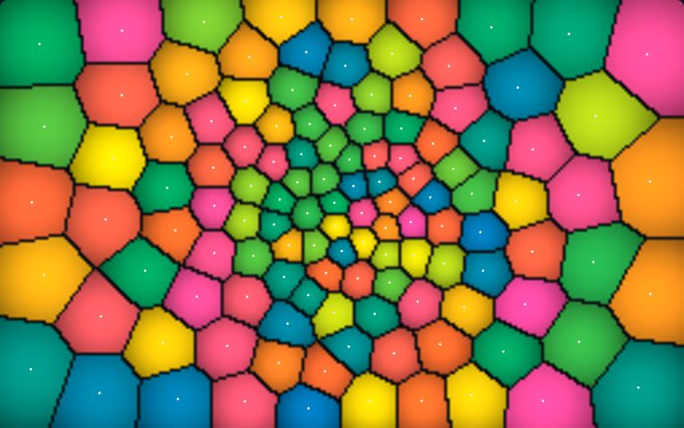</picture></a><br>
<b><a href="https://korczis.github.io/algoglyph/#/p/voronoi-relax">113 · Lloyd's Stained Glass</a></b><br>
Random seeds split the plane into Voronoi cells; Lloyd's algorithm walks each seed to its cell's centroid until the glass settles into an even honeycomb.<br>
<sub>Proximity · O(pixels) per frame, bucket search · computational geometry, Voronoi, Lloyd</sub>
<br><sub>Pointer: Click to add a seed.</sub>
</td>
<td width="50%" valign="top">
<b><a href="https://korczis.github.io/algoglyph/#/p/voronoi-diagram">114 · Voronoi diagram and Delaunay triangulation</a></b><br>
The regions closest to each site, and the triangulation that is their dual.<br>
<sub>Proximity · O(n²) flips in the worst case; O(n log n) expected with a randomised insertion order, which this plate does not use · voronoi, delaunay, duality</sub>
</td>
</tr>
<tr>
<td width="50%" valign="top">
<b><a href="https://korczis.github.io/algoglyph/#/p/dbscan">115 · DBSCAN</a></b><br>
Clusters grow from points with enough neighbours; whatever is reached by none is noise.<br>
<sub>Clustering · O(n²) with the linear-scan neighbourhoods used here; a spatial index brings each query down to its neighbours · clustering, density, noise</sub>
</td>
<td width="50%" valign="top">
<b><a href="https://korczis.github.io/algoglyph/#/p/k-means-plus-plus">116 · k-means++</a></b><br>
Seed centres far apart, then alternate assignment and averaging until nothing moves.<br>
<sub>Clustering · O(nk) per Lloyd iteration and O(nk) for the seeding · clustering, k-means, seeding</sub>
</td>
</tr>
<tr>
<td width="50%" valign="top">
<b><a href="https://korczis.github.io/algoglyph/#/p/haversine-hhi">117 · Radius rings and market concentration</a></b><br>
Great-circle distances bin competitors into rings, and the Herfindahl index measures their concentration.<br>
<sub>Maps and the globe · O(n) haversine evaluations, then O(n) per ring · haversine, great circle, herfindahl</sub>
</td>
<td width="50%" valign="top">
<b><a href="https://korczis.github.io/algoglyph/#/p/map-projections">118 · Web Mercator and Křovák projections</a></b><br>
How two projections bend the same graticule, measured by their distortion at each point.<br>
<sub>Maps and the globe · O(1) per projected point; the Křovák inverse iterates its latitude to convergence · projections, mercator, krovak, distortion</sub>
</td>
</tr>
</table>

### Graphs and networks

<sub>Vertices and edges — searched, connected, spanned, routed, measured and laid out. 42 live plates, 0 planned.</sub>

<table>
<tr>
<td width="50%" valign="top">
<b><a href="https://korczis.github.io/algoglyph/#/p/breadth-first-search">119 · Breadth-first search</a></b><br>
Visit vertices in order of distance, a queue holding the frontier.<br>
<sub>Graph search · O(V + E) · bfs, graph search, queue</sub>
<br><sub>Pointer: Tap a vertex to start from it.</sub>
</td>
<td width="50%" valign="top">
<b><a href="https://korczis.github.io/algoglyph/#/p/depth-first-search">120 · Depth-first search</a></b><br>
Go as deep as possible, back up only when stuck; the tree edges and back edges it leaves.<br>
<sub>Graph search · O(V + E) · dfs, graph search, stack</sub>
<br><sub>Pointer: Tap a vertex to start from it.</sub>
</td>
</tr>
<tr>
<td width="50%" valign="top">
<a href="https://korczis.github.io/algoglyph/#/p/maze-flood"><picture><source media="(prefers-color-scheme: light)" srcset="docs/previews/maze-flood-light.jpg">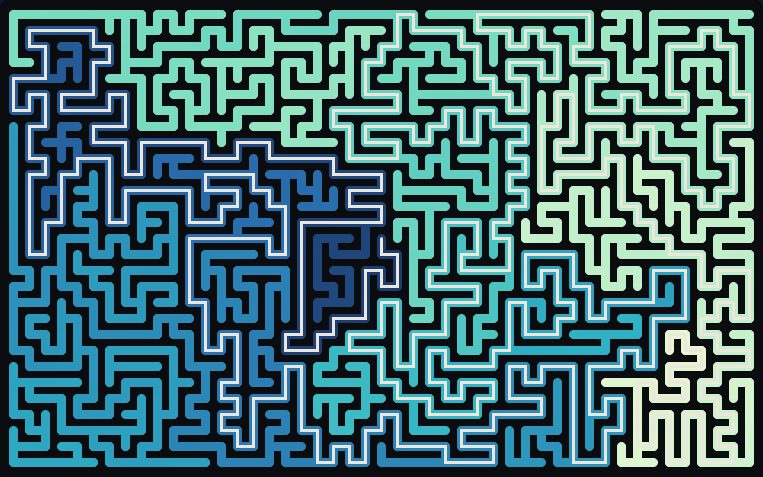</picture></a><br>
<b><a href="https://korczis.github.io/algoglyph/#/p/maze-flood">121 · Maze &amp; Flood</a></b><br>
A perfect maze carved cell by cell, then flooded breadth-first from its heart: colour is distance, the white thread is the longest shortest path.<br>
<sub>Graph search · O(cells) carve, O(cells) BFS · graphs, spanning tree, BFS</sub>
</td>
<td width="50%" valign="top">
<b><a href="https://korczis.github.io/algoglyph/#/p/articulation-points">122 · Articulation points and biconnected components</a></b><br>
The vertices whose removal disconnects the graph, and the blocks they separate.<br>
<sub>Connectivity · O(V + E) · articulation points, biconnectivity, dfs</sub>
<br><sub>Pointer: Tap a vertex to start from it.</sub>
</td>
</tr>
<tr>
<td width="50%" valign="top">
<b><a href="https://korczis.github.io/algoglyph/#/p/bridges">123 · Bridges</a></b><br>
The edges whose removal disconnects the graph, found from DFS low points.<br>
<sub>Connectivity · O(V + E) · bridges, edge connectivity, dfs</sub>
<br><sub>Pointer: Tap a vertex to start from it.</sub>
</td>
<td width="50%" valign="top">
<b><a href="https://korczis.github.io/algoglyph/#/p/ownership-cycles">124 · Circular ownership by DFS colouring</a></b><br>
White, grey and black vertices: a grey vertex met again closes a cycle of companies owning each other.<br>
<sub>Connectivity · O(V + E) · cycles, ownership, dfs colouring</sub>
</td>
</tr>
<tr>
<td width="50%" valign="top">
<b><a href="https://korczis.github.io/algoglyph/#/p/connected-components">125 · Connected components</a></b><br>
Label every vertex with the component a search from it reaches.<br>
<sub>Connectivity · O(V + E) · components, dfs</sub>
</td>
<td width="50%" valign="top">
<b><a href="https://korczis.github.io/algoglyph/#/p/euler-tour">126 · Euler tour</a></b><br>
A walk that uses every edge exactly once, built by splicing cycles.<br>
<sub>Connectivity · O(V + E) · euler, tours, stack</sub>
<br><sub>Pointer: Tap a vertex to start from it.</sub>
</td>
</tr>
<tr>
<td width="50%" valign="top">
<b><a href="https://korczis.github.io/algoglyph/#/p/hamilton-path">127 · Hamilton path by backtracking</a></b><br>
A path through every vertex once, found by exhaustive search with backtracking.<br>
<sub>Connectivity · exponential in the worst case; the problem is NP-complete · backtracking, np-complete, paths</sub>
</td>
<td width="50%" valign="top">
<b><a href="https://korczis.github.io/algoglyph/#/p/kosaraju-scc">128 · Strong components (Kosaraju)</a></b><br>
A DFS on the reverse graph, then one on the graph in reverse postorder: each tree is a strong component.<br>
<sub>Digraphs and DAGs · O(V + E) · strong components, dfs, reverse graph</sub>
</td>
</tr>
<tr>
<td width="50%" valign="top">
<b><a href="https://korczis.github.io/algoglyph/#/p/tarjan-scc">129 · Strong components (Tarjan)</a></b><br>
One DFS with a stack and low links pops each strong component as it completes.<br>
<sub>Digraphs and DAGs · O(V + E) · strong components, dfs, low link</sub>
</td>
<td width="50%" valign="top">
<b><a href="https://korczis.github.io/algoglyph/#/p/topological-sort">130 · Topological sort</a></b><br>
Reverse postorder of a DFS puts every edge pointing forward.<br>
<sub>Digraphs and DAGs · O(V + E) · dag, topological order, dfs</sub>
</td>
</tr>
<tr>
<td width="50%" valign="top">
<b><a href="https://korczis.github.io/algoglyph/#/p/transitive-closure">131 · Transitive closure (Warshall)</a></b><br>
Who can reach whom, filled into a matrix one intermediate vertex at a time.<br>
<sub>Digraphs and DAGs · O(V³) · transitive closure, reachability, matrix</sub>
</td>
<td width="50%" valign="top">
<b><a href="https://korczis.github.io/algoglyph/#/p/boruvka-mst">132 · Borůvka's algorithm</a></b><br>
Every component takes its cheapest outgoing edge at once, and the components at least halve.<br>
<sub>Minimum spanning trees · O(E log V) · mst, parallel, components</sub>
</td>
</tr>
<tr>
<td width="50%" valign="top">
<b><a href="https://korczis.github.io/algoglyph/#/p/euclidean-mst">133 · Euclidean minimum spanning tree</a></b><br>
The MST of points in the plane, found among the edges of their Delaunay triangulation.<br>
<sub>Minimum spanning trees · O(n²) here (Bowyer–Watson insertion); O(n log n) with a faster triangulation · mst, geometry, delaunay</sub>
</td>
<td width="50%" valign="top">
<b><a href="https://korczis.github.io/algoglyph/#/p/kruskal-mst">134 · Kruskal's algorithm</a></b><br>
Take edges cheapest first, skipping any that would close a cycle.<br>
<sub>Minimum spanning trees · O(E log E) · mst, greedy, union-find</sub>
</td>
</tr>
<tr>
<td width="50%" valign="top">
<b><a href="https://korczis.github.io/algoglyph/#/p/prim-mst">135 · Prim's algorithm</a></b><br>
Grow one tree, always adding the cheapest edge leaving it.<br>
<sub>Minimum spanning trees · O(E log V) with a binary heap · mst, greedy, priority queue</sub>
<br><sub>Pointer: Tap a vertex to start from it.</sub>
</td>
<td width="50%" valign="top">
<b><a href="https://korczis.github.io/algoglyph/#/p/bellman-ford">136 · Bellman–Ford</a></b><br>
Relax every edge V − 1 times; one more round that still improves reveals a negative cycle.<br>
<sub>Shortest paths · O(VE) · shortest paths, negative weights, relaxation</sub>
<br><sub>Pointer: Tap a vertex to start from it.</sub>
</td>
</tr>
<tr>
<td width="50%" valign="top">
<a href="https://korczis.github.io/algoglyph/#/p/pathfinding-terrain"><picture><source media="(prefers-color-scheme: light)" srcset="docs/previews/pathfinding-terrain-light.jpg">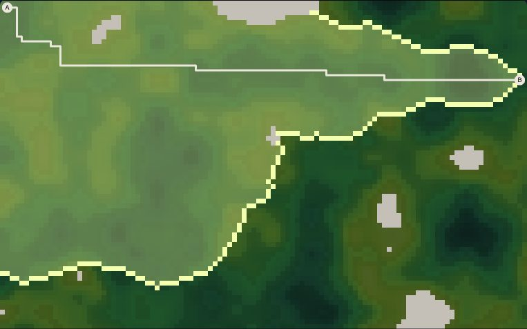</picture></a><br>
<b><a href="https://korczis.github.io/algoglyph/#/p/pathfinding-terrain">137 · Cartographer</a></b><br>
Three searches cross the same hills: Dijkstra floods everything, A* leans towards the goal, greedy sprints and pays for it. Same map, measured costs.<br>
<sub>Shortest paths · O(E log V), binary heap · graphs, A*, heuristics</sub>
</td>
<td width="50%" valign="top">
<b><a href="https://korczis.github.io/algoglyph/#/p/dijkstra">138 · Dijkstra's algorithm</a></b><br>
Settle vertices in order of distance, relaxing the edges of each one settled.<br>
<sub>Shortest paths · O(E log V) with a binary heap · shortest paths, greedy, priority queue</sub>
<br><sub>Pointer: Tap a vertex to start from it.</sub>
</td>
</tr>
<tr>
<td width="50%" valign="top">
<b><a href="https://korczis.github.io/algoglyph/#/p/floyd-warshall">139 · Floyd–Warshall</a></b><br>
All-pairs distances, improved through one intermediate vertex at a time.<br>
<sub>Shortest paths · O(V³) · all pairs, shortest paths, matrix</sub>
</td>
<td width="50%" valign="top">
<b><a href="https://korczis.github.io/algoglyph/#/p/credible-path">140 · Most credible path</a></b><br>
Dijkstra over edge costs of one minus confidence: the best-supported link between two entities.<br>
<sub>Shortest paths · O(E log V) · dijkstra, confidence, evidence</sub>
<br><sub>Pointer: Tap a vertex to start from it.</sub>
</td>
</tr>
<tr>
<td width="50%" valign="top">
<b><a href="https://korczis.github.io/algoglyph/#/p/dag-shortest-paths">141 · Shortest paths in a DAG</a></b><br>
Relax edges in topological order: linear time, negative weights allowed.<br>
<sub>Shortest paths · O(V + E) · dag, shortest paths, topological order</sub>
<br><sub>Pointer: Tap a vertex to start from it.</sub>
</td>
<td width="50%" valign="top">
<b><a href="https://korczis.github.io/algoglyph/#/p/yen-k-shortest">142 · Yen's k shortest paths</a></b><br>
The best path, then the best that differs from it, and so on, by spur paths.<br>
<sub>Shortest paths · O(k V E log V) with a binary heap · k shortest paths, alternatives</sub>
<br><sub>Pointer: Tap a vertex to start from it.</sub>
</td>
</tr>
<tr>
<td width="50%" valign="top">
<b><a href="https://korczis.github.io/algoglyph/#/p/ford-fulkerson">143 · Augmenting paths (Ford–Fulkerson)</a></b><br>
Push flow along any path with spare capacity until none is left; the saturated edges form a cut.<br>
<sub>Flows and matching · O(E f) for integer capacities, f the maximum flow · max flow, augmenting paths, cuts</sub>
</td>
<td width="50%" valign="top">
<b><a href="https://korczis.github.io/algoglyph/#/p/bipartite-matching">144 · Bipartite matching</a></b><br>
Pair up two sides along alternating paths, as a flow problem in disguise.<br>
<sub>Flows and matching · O(V E) · matching, bipartite, augmenting paths</sub>
</td>
</tr>
<tr>
<td width="50%" valign="top">
<b><a href="https://korczis.github.io/algoglyph/#/p/min-cost-flow">145 · Minimum-cost flow</a></b><br>
A maximum flow whose cost is reduced by cancelling negative cycles in the residual graph.<br>
<sub>Flows and matching · O(VE) per cancelled cycle (Bellman–Ford); with integer costs the cycles are finite · min cost flow, negative cycles</sub>
</td>
<td width="50%" valign="top">
<b><a href="https://korczis.github.io/algoglyph/#/p/preflow-push">146 · Preflow-push</a></b><br>
Flood the network from the source and push excess downhill until it drains.<br>
<sub>Flows and matching · O(V³) with a FIFO queue of active vertices · max flow, push relabel</sub>
</td>
</tr>
<tr>
<td width="50%" valign="top">
<b><a href="https://korczis.github.io/algoglyph/#/p/edmonds-karp">147 · Shortest augmenting paths (Edmonds–Karp)</a></b><br>
Augment along the shortest path each time, which bounds the rounds by VE/2.<br>
<sub>Flows and matching · O(V E²) · max flow, bfs</sub>
</td>
<td width="50%" valign="top">
<b><a href="https://korczis.github.io/algoglyph/#/p/brandes-betweenness">148 · Betweenness centrality (Brandes)</a></b><br>
How many shortest paths pass through each vertex, accumulated backwards from every source.<br>
<sub>Network analysis · O(VE) for unweighted graphs · betweenness, brokers, centrality</sub>
</td>
</tr>
<tr>
<td width="50%" valign="top">
<b><a href="https://korczis.github.io/algoglyph/#/p/centrality-comparison">149 · Degree, closeness and eigenvector centrality</a></b><br>
Three answers to who is central, side by side on one graph.<br>
<sub>Network analysis · degree O(E); closeness O(VE); eigenvector O(E) per power-iteration round · centrality, ranking</sub>
</td>
<td width="50%" valign="top">
<b><a href="https://korczis.github.io/algoglyph/#/p/effective-ownership">150 · Effective beneficial ownership</a></b><br>
Multiply shares along every ownership path and add the paths: who really owns how much.<br>
<sub>Network analysis · O(E) per round · ownership, paths, products</sub>
<br><sub>Pointer: Tap a company to make it the target.</sub>
</td>
</tr>
<tr>
<td width="50%" valign="top">
<b><a href="https://korczis.github.io/algoglyph/#/p/ego-network">151 · Ego network expansion</a></b><br>
The neighbourhood of one subject, revealed one hop at a time.<br>
<sub>Network analysis · O(V + E) within the neighbourhood · ego network, k-hop, pivoting</sub>
<br><sub>Pointer: Tap a vertex to make it the subject.</sub>
</td>
<td width="50%" valign="top">
<b><a href="https://korczis.github.io/algoglyph/#/p/label-propagation">152 · Label propagation</a></b><br>
Every vertex adopts the most common label among its neighbours until the labels settle.<br>
<sub>Network analysis · O(E) per round · communities, label propagation</sub>
</td>
</tr>
<tr>
<td width="50%" valign="top">
<b><a href="https://korczis.github.io/algoglyph/#/p/louvain-leiden">153 · Louvain and Leiden communities</a></b><br>
Move vertices to the neighbour community that most raises modularity, then contract and repeat.<br>
<sub>Network analysis · O(E) per sweep of local moving · communities, modularity, clustering</sub>
</td>
<td width="50%" valign="top">
<b><a href="https://korczis.github.io/algoglyph/#/p/pagerank">154 · PageRank</a></b><br>
Influence as the stationary distribution of a random surfer who sometimes teleports.<br>
<sub>Network analysis · O(E) per round; the error shrinks by a factor d per round · pagerank, power iteration, influence</sub>
</td>
</tr>
<tr>
<td width="50%" valign="top">
<b><a href="https://korczis.github.io/algoglyph/#/p/personalised-pagerank">155 · Personalised PageRank</a></b><br>
The surfer teleports only to the subject, so the scores say who matters relative to them.<br>
<sub>Network analysis · O(E) per round; the error shrinks by a factor d per round · pagerank, personalised, proximity</sub>
<br><sub>Pointer: Tap a vertex to make it the subject.</sub>
</td>
<td width="50%" valign="top">
<b><a href="https://korczis.github.io/algoglyph/#/p/spreading-activation">156 · Spreading activation</a></b><br>
Relevance flows from a seed along weighted edges and fades, choosing what to look at.<br>
<sub>Network analysis · O(E) per round · relevance, activation, weighted graphs</sub>
<br><sub>Pointer: Tap a vertex to make it the seed.</sub>
</td>
</tr>
<tr>
<td width="50%" valign="top">
<b><a href="https://korczis.github.io/algoglyph/#/p/fibonacci-sphere">157 · Fibonacci sphere layout</a></b><br>
Points spread evenly on a sphere by the golden angle, a stable home for a 3D graph.<br>
<sub>Graph layout · O(V + E) · sphere, golden angle, 3d</sub>
<br><sub>Pointer: Tap a vertex to start the placement from it.</sub>
</td>
<td width="50%" valign="top">
<b><a href="https://korczis.github.io/algoglyph/#/p/force-atlas2">158 · ForceAtlas2 layout</a></b><br>
Repulsion between all vertices, attraction along edges and gravity to the centre, settling into a readable map.<br>
<sub>Graph layout · O(V² + E) per iteration with exact repulsion; O(V log V + E) with Barnes–Hut · force-directed, layout, barnes-hut</sub>
</td>
</tr>
<tr>
<td width="50%" valign="top">
<b><a href="https://korczis.github.io/algoglyph/#/p/geo-graph">159 · Graph over a map</a></b><br>
A force layout whose vertices are pulled towards their places on a map.<br>
<sub>Graph layout · O(V² + E) per iteration · geospatial, force-directed, maps</sub>
</td>
<td width="50%" valign="top">
<b><a href="https://korczis.github.io/algoglyph/#/p/sugiyama-layout">160 · Layered DAG layout (Sugiyama)</a></b><br>
Assign layers, order each layer to reduce crossings, then place: how plans are drawn.<br>
<sub>Graph layout · crossing minimisation is NP-hard; each barycentre sweep sorts every layer, O(N log N) for N vertices and dummy nodes · layered layout, crossing minimisation</sub>
</td>
</tr>
</table>

### Numbers and computation

<sub>Random numbers, arithmetic, linear algebra, curve fitting, integration and number theory. 21 live plates, 0 planned.</sub>

<table>
<tr>
<td width="50%" valign="top">
<b><a href="https://korczis.github.io/algoglyph/#/p/additive-congruential">161 · Additive congruential generator</a></b><br>
Each number the sum of two earlier ones in a shift register, with a very long period.<br>
<sub>Random numbers · one addition per number, a table of 55 words · random numbers, lagged fibonacci</sub>
</td>
<td width="50%" valign="top">
<b><a href="https://korczis.github.io/algoglyph/#/p/box-muller">162 · Box–Muller transform</a></b><br>
Two uniform numbers turned into two independent Gaussians by a rotation and a logarithm.<br>
<sub>Random numbers · two uniforms, one logarithm, one square root and a sine–cosine pair per two normals · normal distribution, sampling</sub>
</td>
</tr>
<tr>
<td width="50%" valign="top">
<b><a href="https://korczis.github.io/algoglyph/#/p/linear-congruential">163 · Linear congruential generator</a></b><br>
x ← (ax + c) mod m, and the lattice its consecutive pairs fall on.<br>
<sub>Random numbers · O(1) per number; period at most m · random numbers, lcg, spectral test</sub>
</td>
<td width="50%" valign="top">
<b><a href="https://korczis.github.io/algoglyph/#/p/horner-evaluation">164 · Horner's rule</a></b><br>
Evaluate a polynomial with n multiplications by nesting it from the highest coefficient.<br>
<sub>Arithmetic · n multiplications and n additions for degree n · polynomials, evaluation</sub>
</td>
</tr>
<tr>
<td width="50%" valign="top">
<b><a href="https://korczis.github.io/algoglyph/#/p/karatsuba">165 · Polynomial multiplication by divide and conquer</a></b><br>
Three half-size products instead of four: n^1.58 instead of n².<br>
<sub>Arithmetic · 3^lg n = n^1.585 multiplications for n coefficients · divide and conquer, multiplication</sub>
</td>
<td width="50%" valign="top">
<b><a href="https://korczis.github.io/algoglyph/#/p/strassen">166 · Strassen's matrix multiplication</a></b><br>
Seven half-size products instead of eight: n^2.81.<br>
<sub>Arithmetic · 7^lg n = n^2.807 multiplications, with more additions than the triple loop · matrices, divide and conquer</sub>
</td>
</tr>
<tr>
<td width="50%" valign="top">
<b><a href="https://korczis.github.io/algoglyph/#/p/gaussian-elimination">167 · Gaussian elimination</a></b><br>
Eliminate unknowns column by column, pivoting on the largest entry, then substitute back.<br>
<sub>Linear algebra · about n³/3 multiplications to triangularise, n²/2 to substitute back · linear systems, pivoting</sub>
</td>
<td width="50%" valign="top">
<b><a href="https://korczis.github.io/algoglyph/#/p/pca-svd">168 · Principal components</a></b><br>
Rotate the data onto its axes of greatest variance.<br>
<sub>Linear algebra · O(m d²) per sweep of the one-sided Jacobi method; a few sweeps converge · pca, svd, dimensionality reduction</sub>
</td>
</tr>
<tr>
<td width="50%" valign="top">
<b><a href="https://korczis.github.io/algoglyph/#/p/cubic-splines">169 · Cubic splines</a></b><br>
Piecewise cubics joined with matching slope and curvature, without the wiggles.<br>
<sub>Curve fitting · O(n) to build (one tridiagonal solve), O(log n) per evaluation · splines, interpolation</sub>
</td>
<td width="50%" valign="top">
<b><a href="https://korczis.github.io/algoglyph/#/p/least-squares">170 · Least squares</a></b><br>
The curve that minimises the sum of squared vertical distances.<br>
<sub>Curve fitting · O(m n²) for m samples and n coefficients by Householder QR · regression, least squares</sub>
</td>
</tr>
<tr>
<td width="50%" valign="top">
<b><a href="https://korczis.github.io/algoglyph/#/p/polynomial-interpolation">171 · Polynomial interpolation</a></b><br>
The polynomial through n points, and how it oscillates between equally spaced ones.<br>
<sub>Curve fitting · O(n²) for the divided differences, O(n) per evaluation · interpolation, lagrange, runge</sub>
</td>
<td width="50%" valign="top">
<b><a href="https://korczis.github.io/algoglyph/#/p/adaptive-quadrature">172 · Adaptive quadrature</a></b><br>
Split only where the estimate is not yet good enough.<br>
<sub>Integration · evaluations grow where the integrand is hard, not with the length of the interval · integration, adaptive, recursion</sub>
</td>
</tr>
<tr>
<td width="50%" valign="top">
<b><a href="https://korczis.github.io/algoglyph/#/p/simpson-quadrature">173 · Trapezoid and Simpson quadrature</a></b><br>
Areas under a curve from trapezoids and parabolas, and how fast their error falls.<br>
<sub>Integration · n + 1 evaluations; error O(h²) for trapezoids, O(h⁴) for Simpson on smooth integrands · integration, quadrature</sub>
</td>
<td width="50%" valign="top">
<b><a href="https://korczis.github.io/algoglyph/#/p/particle-swarm">174 · Particle swarm optimisation</a></b><br>
Particles pulled towards their own best and the swarm's best positions.<br>
<sub>Optimisation · swarm size evaluations per iteration · optimisation, swarm</sub>
</td>
</tr>
<tr>
<td width="50%" valign="top">
<b><a href="https://korczis.github.io/algoglyph/#/p/simplex-method">175 · Simplex method</a></b><br>
Walk from vertex to vertex of the feasible polytope, always uphill.<br>
<sub>Optimisation · exponential in the worst case, usually a small multiple of the number of constraints · linear programming, simplex</sub>
</td>
<td width="50%" valign="top">
<b><a href="https://korczis.github.io/algoglyph/#/p/simulated-annealing">176 · Simulated annealing</a></b><br>
Accept worse moves with a probability that cools, to escape local optima.<br>
<sub>Optimisation · one objective evaluation per proposal · optimisation, annealing, metropolis</sub>
</td>
</tr>
<tr>
<td width="50%" valign="top">
<b><a href="https://korczis.github.io/algoglyph/#/p/pick-path-routing">177 · Warehouse pick-path routing</a></b><br>
S-shape, largest-gap and optimal routes through the same picking list, and their walking distances.<br>
<sub>Optimisation · S-shape and largest gap O(n log n); the optimal tour O(2ⁿ n²) by dynamic programming over subsets · routing, tsp, warehouses</sub>
</td>
<td width="50%" valign="top">
<a href="https://korczis.github.io/algoglyph/#/p/collatz-coral"><picture><source media="(prefers-color-scheme: light)" srcset="docs/previews/collatz-coral-light.jpg">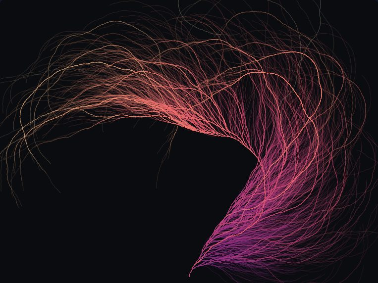</picture></a><br>
<b><a href="https://korczis.github.io/algoglyph/#/p/collatz-coral">178 · Collatz Coral</a></b><br>
Thousands of Collatz orbits drawn backwards from 1, bending one way on even steps and the other on odd: shared tails fuse into coral.<br>
<sub>Number theory · O(Σ stopping times) · number theory, turtle graphics, conjecture</sub>
</td>
</tr>
<tr>
<td width="50%" valign="top">
<b><a href="https://korczis.github.io/algoglyph/#/p/euclid-gcd">179 · Euclid's algorithm</a></b><br>
The greatest common divisor by repeated remainders, the oldest algorithm in use.<br>
<sub>Number theory · O(log min(a, b)) divisions; at most five per decimal digit of the smaller input (Lamé) · gcd, euclid</sub>
</td>
<td width="50%" valign="top">
<b><a href="https://korczis.github.io/algoglyph/#/p/sieve-of-eratosthenes">180 · Sieve of Eratosthenes</a></b><br>
Cross out the multiples of each prime; what survives is prime.<br>
<sub>Number theory · Θ(N log log N) crossings · primes, sieve</sub>
</td>
</tr>
<tr>
<td width="50%" valign="top">
<a href="https://korczis.github.io/algoglyph/#/p/mandelbrot-julia"><picture><source media="(prefers-color-scheme: light)" srcset="docs/previews/mandelbrot-julia-light.jpg">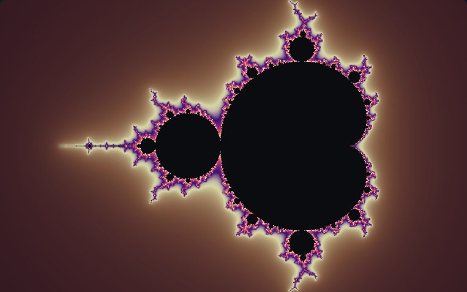</picture></a><br>
<b><a href="https://korczis.github.io/algoglyph/#/p/mandelbrot-julia">181 · Escape Velocity</a></b><br>
Iterate z ← z² + c and count how long each point takes to fly off. The Mandelbrot set and its Julia sets, coloured by a continuous escape count; click to dive in.<br>
<sub>Fractals · O(pixels × iterations), progressive rows · fractals, complex numbers, escape time, dynamics</sub>
<br><sub>Pointer: Click to zoom on a point (the Click menu zooms out instead); in Julia mode with the pointer preset, click or drag to choose c. Defaults or Reseed reset the view.</sub>
</td>
<td width="50%"></td>
</tr>
</table>

### Signals and sound

<sub>Transforms, synthesis and measurement of waves in time and frequency. 14 live plates, 0 planned.</sub>

<table>
<tr>
<td width="50%" valign="top">
<b><a href="https://korczis.github.io/algoglyph/#/p/daubechies-dwt">182 · Daubechies wavelet transform</a></b><br>
A signal split into detail and approximation, octave by octave.<br>
<sub>Transforms · O(N · L) for a filter of length L; each level halves the work · wavelets, multi-scale, dwt</sub>
</td>
<td width="50%" valign="top">
<a href="https://korczis.github.io/algoglyph/#/p/fourier-epicycles"><picture><source media="(prefers-color-scheme: light)" srcset="docs/previews/fourier-epicycles-light.jpg">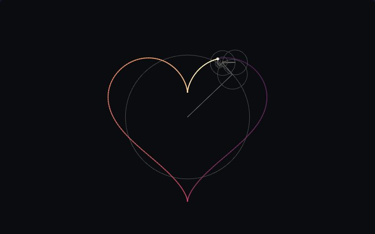</picture></a><br>
<b><a href="https://korczis.github.io/algoglyph/#/p/fourier-epicycles">183 · Epicycle Engine</a></b><br>
A chain of rotating circles, one per Fourier coefficient, redraws a closed curve. Take terms away and the corners are the first thing to melt.<br>
<sub>Transforms · O(N²) DFT once, O(terms) per frame · Fourier, complex numbers, signal processing</sub>
</td>
</tr>
<tr>
<td width="50%" valign="top">
<b><a href="https://korczis.github.io/algoglyph/#/p/fft-butterfly">184 · Fast Fourier transform</a></b><br>
Radix-2 butterflies combine half-size transforms after a bit-reversed shuffle.<br>
<sub>Transforms · O(N log N): N/2 butterflies in each of log2 N stages · fft, butterflies, bit reversal</sub>
</td>
<td width="50%" valign="top">
<b><a href="https://korczis.github.io/algoglyph/#/p/hilbert-analytic">185 · Hilbert transform and the analytic signal</a></b><br>
The envelope and instantaneous frequency of a signal from its analytic counterpart.<br>
<sub>Transforms · O(N log N): one forward and one inverse FFT · hilbert, envelope, instantaneous frequency</sub>
</td>
</tr>
<tr>
<td width="50%" valign="top">
<b><a href="https://korczis.github.io/algoglyph/#/p/stft-spectrogram">186 · Spectrogram</a></b><br>
Short windowed transforms over time, averaged by Welch's method into a waterfall.<br>
<sub>Transforms · O(F · M log M) for F frames of M samples · stft, spectrogram, waterfall</sub>
</td>
<td width="50%" valign="top">
<b><a href="https://korczis.github.io/algoglyph/#/p/window-leakage">187 · Windows and spectral leakage</a></b><br>
A tone between bins smears across the spectrum; each window trades width for side lobes.<br>
<sub>Transforms · O(N log N) per spectrum · windows, leakage, hann, blackman</sub>
</td>
</tr>
<tr>
<td width="50%" valign="top">
<b><a href="https://korczis.github.io/algoglyph/#/p/additive-gibbs">188 · Additive synthesis and the Gibbs phenomenon</a></b><br>
Square and saw waves from harmonics, and the overshoot that never goes away.<br>
<sub>Synthesis · O(K · N) for K harmonics over N samples · fourier series, gibbs, band limiting</sub>
</td>
<td width="50%" valign="top">
<b><a href="https://korczis.github.io/algoglyph/#/p/fm-synthesis">189 · FM synthesis and Bessel sidebands</a></b><br>
One oscillator modulating another's frequency, its sidebands weighted by Bessel functions.<br>
<sub>Synthesis · O(N log N) per spectrum · fm, bessel, operators</sub>
</td>
</tr>
<tr>
<td width="50%" valign="top">
<b><a href="https://korczis.github.io/algoglyph/#/p/noise-colours">190 · White, pink and brown noise</a></b><br>
Noise whose power falls by 0, 3 and 6 dB per octave, and the filters that colour it.<br>
<sub>Synthesis · O(n) to generate; O(n log M) for the Welch estimate · noise, 1/f, filters</sub>
</td>
<td width="50%" valign="top">
<b><a href="https://korczis.github.io/algoglyph/#/p/biquad-filters">191 · Biquad filters, poles and zeros</a></b><br>
Moving poles and zeros on the z-plane and watching the frequency response follow.<br>
<sub>Filters · O(1) per sample: five multiplies · filters, poles, zeros, frequency response</sub>
</td>
</tr>
<tr>
<td width="50%" valign="top">
<b><a href="https://korczis.github.io/algoglyph/#/p/xcorr-alignment">192 · Alignment by cross-correlation</a></b><br>
The lag between two captures, to a fraction of a sample, by correlating them.<br>
<sub>Measurement · O(N · L) for L lags, directly; O(N log N) by FFT · cross-correlation, alignment, sinc</sub>
</td>
<td width="50%" valign="top">
<b><a href="https://korczis.github.io/algoglyph/#/p/sine-sweep-ir">193 · Sine sweep and impulse response</a></b><br>
An exponential sweep through a system, deconvolved into its impulse response.<br>
<sub>Measurement · O(n log n) by FFT convolution · impulse response, deconvolution, sweep</sub>
</td>
</tr>
<tr>
<td width="50%" valign="top">
<b><a href="https://korczis.github.io/algoglyph/#/p/yin-pitch">194 · YIN pitch detection</a></b><br>
A difference function with cumulative normalisation that finds the fundamental period.<br>
<sub>Measurement · O(W · τmax) per frame · pitch, autocorrelation, yin</sub>
</td>
<td width="50%" valign="top">
<b><a href="https://korczis.github.io/algoglyph/#/p/adsb-cpr">195 · ADS-B position decoding</a></b><br>
Compact position reports from two frames combined into a latitude and longitude.<br>
<sub>Radio · O(1) per frame: a CRC over 88 bits and a few divisions · ads-b, cpr, crc-24, aircraft</sub>
</td>
</tr>
</table>

### Dynamics and complexity

<sub>Chaos, synchrony, emergence and the analysis of trajectories. 14 live plates, 0 planned.</sub>

<table>
<tr>
<td width="50%" valign="top">
<a href="https://korczis.github.io/algoglyph/#/p/double-pendulum"><picture><source media="(prefers-color-scheme: light)" srcset="docs/previews/double-pendulum-light.jpg">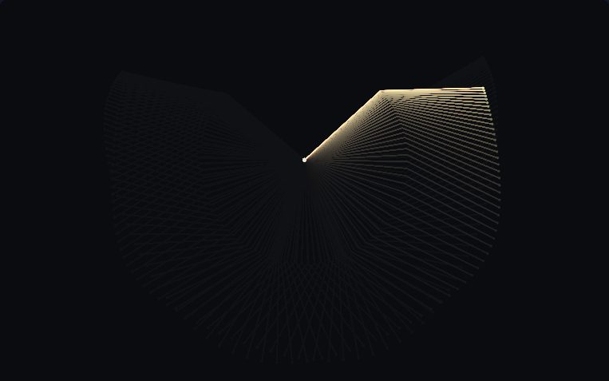</picture></a><br>
<b><a href="https://korczis.github.io/algoglyph/#/p/double-pendulum">196 · Chaos Fan</a></b><br>
A fan of double pendulums released a millionth of a radian apart: for a few swings they move as one, then chaos tears them into a spray.<br>
<sub>Chaos · RK4, O(pendulums) per step · chaos, Runge–Kutta, Hamiltonian</sub>
</td>
<td width="50%" valign="top">
<b><a href="https://korczis.github.io/algoglyph/#/p/lyapunov-exponent">197 · Largest Lyapunov exponent</a></b><br>
Two nearby trajectories, their separation renormalised and averaged into a growth rate.<br>
<sub>Chaos · linear in the integration time; the estimate converges slowly, like a mean · lyapunov, divergence, chaos</sub>
</td>
</tr>
<tr>
<td width="50%" valign="top">
<a href="https://korczis.github.io/algoglyph/#/p/lorenz-attractor"><picture><source media="(prefers-color-scheme: light)" srcset="docs/previews/lorenz-attractor-light.jpg">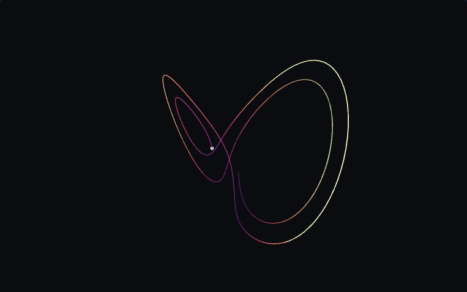</picture></a><br>
<b><a href="https://korczis.github.io/algoglyph/#/p/lorenz-attractor">198 · Lorenz Butterfly</a></b><br>
A swarm of tracers on the Lorenz system, released a hair apart, smearing across both wings of the strange attractor. Drag to orbit, scroll to zoom.<br>
<sub>Chaos · RK4, O(tracers × trail) · chaos, strange attractor, 3D</sub>
<br><sub>Pointer: Drag to orbit, scroll to zoom.</sub>
</td>
<td width="50%" valign="top">
<b><a href="https://korczis.github.io/algoglyph/#/p/poincare-section">199 · Poincaré section</a></b><br>
Where a trajectory pierces a plane, turning a flow into a map.<br>
<sub>Chaos · linear in the integration time · poincare, maps, orbits</sub>
</td>
</tr>
<tr>
<td width="50%" valign="top">
<b><a href="https://korczis.github.io/algoglyph/#/p/takens-embedding">200 · Delay embedding (Takens)</a></b><br>
An attractor reconstructed from one observed signal and its delays.<br>
<sub>Time-series analysis · O(N²) per dimension for the false-neighbour search over N vectors · phase space, embedding, false nearest neighbours</sub>
</td>
<td width="50%" valign="top">
<b><a href="https://korczis.github.io/algoglyph/#/p/hurst-dfa">201 · Hurst exponent and detrended fluctuation</a></b><br>
Whether a series' trends persist or reverse, from how its fluctuations scale.<br>
<sub>Time-series analysis · O(N) per window size, O(N log N) over the logarithmic set of sizes · hurst, dfa, long memory</sub>
</td>
</tr>
<tr>
<td width="50%" valign="top">
<b><a href="https://korczis.github.io/algoglyph/#/p/recurrence-plot">202 · Recurrence plot and quantification</a></b><br>
When the trajectory returns near where it has been, drawn as a matrix whose texture changes with regime.<br>
<sub>Time-series analysis · O(N²) for N states · recurrence, rqa, regime change</sub>
</td>
<td width="50%" valign="top">
<b><a href="https://korczis.github.io/algoglyph/#/p/drift-divergence">203 · Distribution drift: PSI, KL and Jensen–Shannon</a></b><br>
Two histograms pulling apart, measured three ways.<br>
<sub>Change and drift · linear in the samples per window, then linear in the bins · drift, divergence, psi</sub>
</td>
</tr>
<tr>
<td width="50%" valign="top">
<b><a href="https://korczis.github.io/algoglyph/#/p/page-hinkley">204 · Page–Hinkley change detection</a></b><br>
A cumulative deviation that alarms when the mean of a stream has moved.<br>
<sub>Change and drift · constant time and memory per sample · change detection, cusum</sub>
</td>
<td width="50%" valign="top">
<b><a href="https://korczis.github.io/algoglyph/#/p/kuramoto">205 · Kuramoto synchronisation</a></b><br>
Coupled oscillators locking into phase as the coupling passes a critical strength.<br>
<sub>Synchrony · O(N) per step in the mean-field form · synchronisation, oscillators, order parameter</sub>
</td>
</tr>
<tr>
<td width="50%" valign="top">
<b><a href="https://korczis.github.io/algoglyph/#/p/lissajous">206 · Lissajous figures and phase</a></b><br>
Two sinusoids on two axes: the figure reads their frequency ratio and phase.<br>
<sub>Synchrony · O(N log N) to read ratio and phase back · phase, lissajous, oscilloscope</sub>
</td>
<td width="50%" valign="top">
<a href="https://korczis.github.io/algoglyph/#/p/boids-3d"><picture><source media="(prefers-color-scheme: light)" srcset="docs/previews/boids-3d-light.jpg">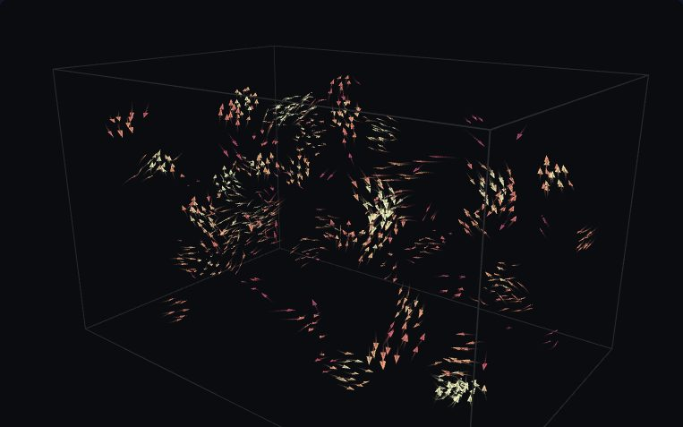</picture></a><br>
<b><a href="https://korczis.github.io/algoglyph/#/p/boids-3d">207 · Murmuration</a></b><br>
Reynolds boids in a box: separation, alignment and cohesion among near neighbours, found with a uniform grid, fold a random swarm into flowing flocks. Drag to orbit.<br>
<sub>Collective motion · O(N·k) per step, uniform grid (k neighbours a bird) · flocking, emergence, spatial grid, 3D</sub>
<br><sub>Pointer: Drag to orbit, scroll to zoom.</sub>
</td>
</tr>
<tr>
<td width="50%" valign="top">
<a href="https://korczis.github.io/algoglyph/#/p/rule-weaver"><picture><source media="(prefers-color-scheme: light)" srcset="docs/previews/rule-weaver-light.jpg">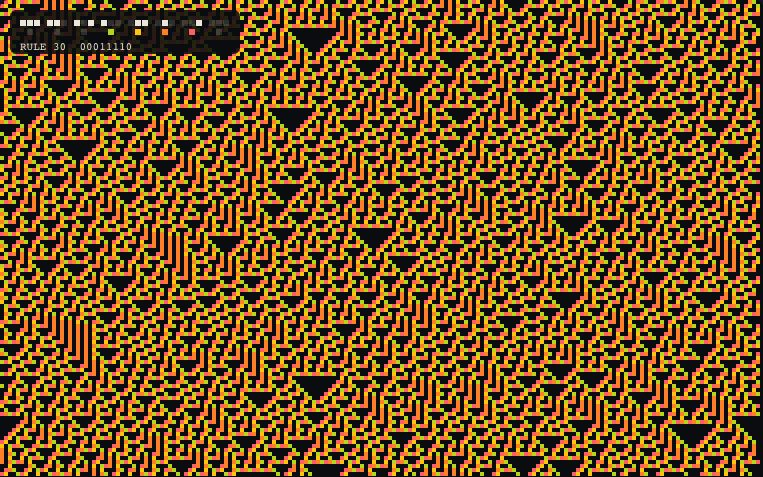</picture></a><br>
<b><a href="https://korczis.github.io/algoglyph/#/p/rule-weaver">208 · Rule Weaver</a></b><br>
An elementary cellular automaton woven row by row; each live cell is coloured by which of the eight rule bits gave birth to it.<br>
<sub>Cellular automata · O(width) per generation · cellular automata, Wolfram, bits</sub>
</td>
<td width="50%" valign="top">
<a href="https://korczis.github.io/algoglyph/#/p/gray-scott"><picture><source media="(prefers-color-scheme: light)" srcset="docs/previews/gray-scott-light.jpg">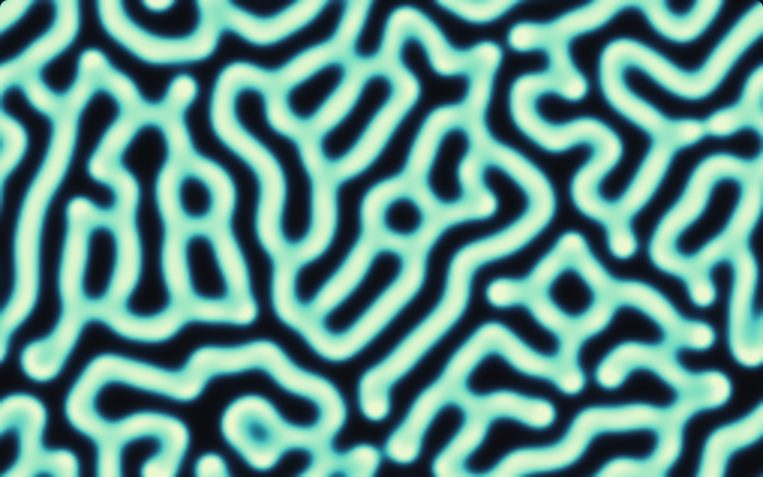</picture></a><br>
<b><a href="https://korczis.github.io/algoglyph/#/p/gray-scott">209 · Turing Garden</a></b><br>
Two chemicals, one feeding and one eating, diffusing at different speeds: the Gray-Scott model grows coral, divides cells and draws mazes. Paint to seed it.<br>
<sub>Pattern formation · O(cells) per step, explicit Euler · reaction-diffusion, Turing patterns, PDE</sub>
<br><sub>Pointer: Click or drag to seed chemical V.</sub>
</td>
</tr>
</table>

### Physics

<sub>Mechanics, gravitation, waves, fluids and statistical physics, integrated honestly. 9 live plates, 0 planned.</sub>

<table>
<tr>
<td width="50%" valign="top">
<a href="https://korczis.github.io/algoglyph/#/p/foucault-pendulum"><picture><source media="(prefers-color-scheme: light)" srcset="docs/previews/foucault-pendulum-light.jpg">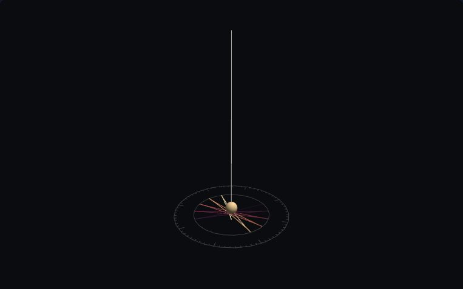</picture></a><br>
<b><a href="https://korczis.github.io/algoglyph/#/p/foucault-pendulum">210 · Foucault's Rosette</a></b><br>
A pendulum in the Panthéon, with the Earth spun up a few thousand times: its swing plane turns under it and its shadow draws a rosette on the floor. Drag to orbit.<br>
<sub>Mechanics · RK4, constant per step · Coriolis, rotating frame, 3D</sub>
<br><sub>Pointer: Drag to orbit, scroll to zoom.</sub>
</td>
<td width="50%" valign="top">
<b><a href="https://korczis.github.io/algoglyph/#/p/soft-body-3d">211 · Jelly Physics</a></b><br>
Point masses on damped springs: drop a jelly cube or a gas-filled ball on the floor, or watch a column pinned at its base wobble. Colour is the local strain.<br>
<sub>Mechanics · O(springs + faces) per step, velocity Verlet · mass-spring, Verlet, pressure, 3D</sub>
<br><sub>Pointer: Drag to orbit, scroll to zoom.</sub>
</td>
</tr>
<tr>
<td width="50%" valign="top">
<a href="https://korczis.github.io/algoglyph/#/p/verlet-cloth"><picture><source media="(prefers-color-scheme: light)" srcset="docs/previews/verlet-cloth-light.jpg">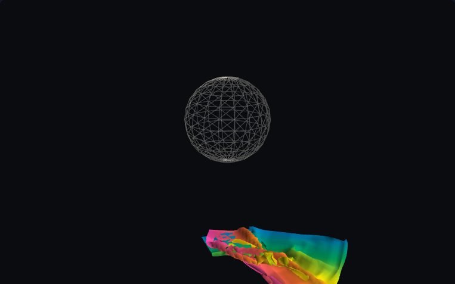</picture></a><br>
<b><a href="https://korczis.github.io/algoglyph/#/p/verlet-cloth">212 · Verlet Cloth</a></b><br>
A sheet of particles held together by distance constraints: hang it as a curtain, pin it by two corners, or drop it over a sphere, then blow wind through it.<br>
<sub>Mechanics · O(links × iterations) per step · Verlet, constraints, 3D</sub>
<br><sub>Pointer: Drag to orbit, scroll to zoom.</sub>
</td>
<td width="50%" valign="top">
<a href="https://korczis.github.io/algoglyph/#/p/n-body"><picture><source media="(prefers-color-scheme: light)" srcset="docs/previews/n-body-light.jpg">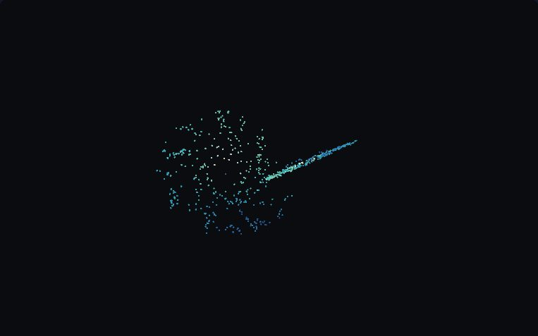</picture></a><br>
<b><a href="https://korczis.github.io/algoglyph/#/p/n-body">213 · Galactic Waltz</a></b><br>
Newtonian gravity between every pair of bodies: a disc in orbit, two galaxies colliding, or a cold cube collapsing into a cluster. Drag to orbit.<br>
<sub>Gravitation · O(n²) per step, leapfrog KDK · gravity, symplectic, 3D</sub>
<br><sub>Pointer: Drag to orbit, scroll to zoom.</sub>
</td>
</tr>
<tr>
<td width="50%" valign="top">
<a href="https://korczis.github.io/algoglyph/#/p/barnes-hut"><picture><source media="(prefers-color-scheme: light)" srcset="docs/previews/barnes-hut-light.jpg">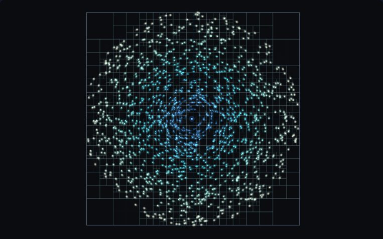</picture></a><br>
<b><a href="https://korczis.github.io/algoglyph/#/p/barnes-hut">214 · Quadtree Cosmos</a></b><br>
Thousands of stars under gravity, and the quadtree that makes it cheap: Barnes–Hut lumps distant stars into one mass and turns N² pairs into N log N.<br>
<sub>Gravitation · O(N log N) per step, leapfrog KDK · quadtree, gravity, approximation</sub>
</td>
<td width="50%" valign="top">
<b><a href="https://korczis.github.io/algoglyph/#/p/quantum-tunnelling">215 · Ghost Through the Wall</a></b><br>
A Gaussian wave packet runs into a barrier it classically cannot climb, and part of it comes out the other side. Below it, the whole history streams down as a space-time ribbon.<br>
<sub>Waves · Split-step Fourier, O(N log N) per step, N = 2048 · quantum mechanics, tunnelling, FFT, split-step</sub>
</td>
</tr>
<tr>
<td width="50%" valign="top">
<a href="https://korczis.github.io/algoglyph/#/p/ripple-tank"><picture><source media="(prefers-color-scheme: light)" srcset="docs/previews/ripple-tank-light.jpg">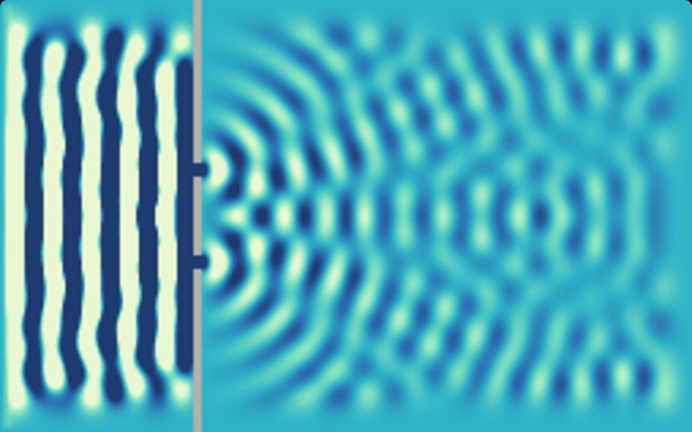</picture></a><br>
<b><a href="https://korczis.github.io/algoglyph/#/p/ripple-tank">216 · Ripple Tank</a></b><br>
The wave equation on a grid: two sources, a double slit, a single slit. Switch to intensity and Young's interference fringes develop out of the noise.<br>
<sub>Waves · O(cells) per step, explicit FD · waves, interference, finite differences</sub>
<br><sub>Pointer: Click or drag to drop pebbles.</sub>
</td>
<td width="50%" valign="top">
<b><a href="https://korczis.github.io/algoglyph/#/p/stable-fluids">217 · Stable fluids</a></b><br>
Diffuse, advect backwards along the velocity, and project out divergence: a fluid that never blows up.<br>
<sub>Fluids · O(n² · sweeps) per step, unconditionally stable · fluids, advection, projection, webassembly</sub>
<br><sub>Pointer: Drag across the box to push dye and momentum.</sub>
</td>
</tr>
<tr>
<td width="50%" valign="top">
<a href="https://korczis.github.io/algoglyph/#/p/ising-model"><picture><source media="(prefers-color-scheme: light)" srcset="docs/previews/ising-model-light.jpg">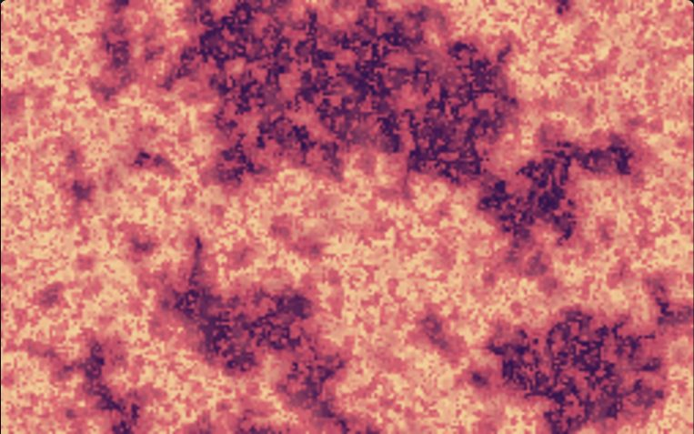</picture></a><br>
<b><a href="https://korczis.github.io/algoglyph/#/p/ising-model">218 · Magnet Weather</a></b><br>
A sheet of tiny magnets, each nudged by its four neighbours and shaken by heat: the 2D Ising model freezes into one colour, boils into noise, and at the critical temperature becomes clouds of every size.<br>
<sub>Statistical physics · O(spins) per sweep, Metropolis single-spin flips · statistical mechanics, phase transition, Monte Carlo</sub>
<br><sub>Pointer: Click or drag to paint a patch of spins opposite to the one under the pointer.</sub>
</td>
<td width="50%"></td>
</tr>
</table>

### Evidence and decisions

<sub>Belief, calibration, attribution, uncertainty and judgement under evidence. 19 live plates, 0 planned.</sub>

<table>
<tr>
<td width="50%" valign="top">
<b><a href="https://korczis.github.io/algoglyph/#/p/ach-matrix">219 · Analysis of competing hypotheses</a></b><br>
Evidence against hypotheses in a matrix, ranked by what contradicts each the least.<br>
<sub>Belief and evidence · O(evidence × hypotheses) to score and rank · hypotheses, evidence, intelligence analysis</sub>
<br><sub>Pointer: Click a cell to cycle its rating through II, I, N, C and CC; the scores and the ranking follow.</sub>
</td>
<td width="50%" valign="top">
<b><a href="https://korczis.github.io/algoglyph/#/p/bayes-update">220 · Bayesian updating</a></b><br>
A prior turned into a posterior one piece of evidence at a time.<br>
<sub>Belief and evidence · one pass over the grid per observation · bayes, posterior, evidence</sub>
</td>
</tr>
<tr>
<td width="50%" valign="top">
<b><a href="https://korczis.github.io/algoglyph/#/p/dempster-shafer">221 · Dempster–Shafer combination</a></b><br>
Belief and plausibility as an interval, and the rule that combines two sources.<br>
<sub>Belief and evidence · quadratic in the number of focal sets per combination · belief functions, plausibility</sub>
</td>
<td width="50%" valign="top">
<b><a href="https://korczis.github.io/algoglyph/#/p/noisy-or">222 · Noisy-OR evidence fusion</a></b><br>
Independent pieces of evidence combine as one minus the product of their failures.<br>
<sub>Belief and evidence · linear in the number of causes · noisy-or, evidence fusion</sub>
</td>
</tr>
<tr>
<td width="50%" valign="top">
<b><a href="https://korczis.github.io/algoglyph/#/p/transitive-support">223 · Transitive support of a conclusion</a></b><br>
How much independent evidence ultimately stands under a conclusion in a reasoning graph.<br>
<sub>Belief and evidence · O(V + E) for the search; O(L E) for L independent lines · reasoning, evidence graphs, support</sub>
<br><sub>Pointer: Tap a claim to make it the conclusion.</sub>
</td>
<td width="50%" valign="top">
<b><a href="https://korczis.github.io/algoglyph/#/p/isotonic-calibration">224 · Calibration by isotonic regression</a></b><br>
Pool adjacent violators until confidence rises with accuracy; the reliability diagram before and after.<br>
<sub>Calibration · linear after sorting the scores · calibration, isotonic, reliability diagram</sub>
</td>
</tr>
<tr>
<td width="50%" valign="top">
<b><a href="https://korczis.github.io/algoglyph/#/p/shapley-values">225 · Shapley values by sampling</a></b><br>
Each input's average marginal contribution over random orderings.<br>
<sub>Attribution and sensitivity · d + 1 model evaluations per sampled ordering of d inputs · shapley, attribution</sub>
</td>
<td width="50%" valign="top">
<b><a href="https://korczis.github.io/algoglyph/#/p/sobol-indices">226 · Sobol sensitivity indices</a></b><br>
The share of output variance each input explains, alone and with the others.<br>
<sub>Attribution and sensitivity · N (d + 2) model evaluations for d inputs · sensitivity, variance decomposition</sub>
</td>
</tr>
<tr>
<td width="50%" valign="top">
<b><a href="https://korczis.github.io/algoglyph/#/p/tornado-sensitivity">227 · Tornado sensitivity</a></b><br>
Each input swung from low to high alone, sorted into a tornado.<br>
<sub>Attribution and sensitivity · 2 d + 1 model evaluations for d inputs, plus the Monte Carlo runs · sensitivity, one at a time</sub>
</td>
<td width="50%" valign="top">
<b><a href="https://korczis.github.io/algoglyph/#/p/pareto-front">228 · Pareto front</a></b><br>
The options no other option beats on every criterion.<br>
<sub>Multi-criteria decisions · O(n log n) for two criteria: one sort, one sweep · pareto, dominance, skyline</sub>
</td>
</tr>
<tr>
<td width="50%" valign="top">
<b><a href="https://korczis.github.io/algoglyph/#/p/topsis">229 · TOPSIS</a></b><br>
Options ranked by closeness to the ideal and distance from the anti-ideal.<br>
<sub>Multi-criteria decisions · O(m k) for m options and k criteria · multi-criteria, ideal point</sub>
</td>
<td width="50%" valign="top">
<b><a href="https://korczis.github.io/algoglyph/#/p/base-rate-roc">230 · Base rates and the ROC curve</a></b><br>
Why a good detector of a rare thing raises mostly false alarms, with the threshold to play with.<br>
<sub>Uncertainty and simulation · n log n to sort the scores for the full curve · base rates, roc, false alarms</sub>
</td>
</tr>
<tr>
<td width="50%" valign="top">
<b><a href="https://korczis.github.io/algoglyph/#/p/bootstrap-ci">231 · Bootstrap confidence intervals</a></b><br>
Resample the data with replacement and read the interval off the resampled statistic.<br>
<sub>Uncertainty and simulation · B n draws for B resamples of n points · bootstrap, resampling, confidence</sub>
</td>
<td width="50%" valign="top">
<b><a href="https://korczis.github.io/algoglyph/#/p/conformal-intervals">232 · Conformal prediction intervals</a></b><br>
Intervals from held-out residuals that cover the truth at the stated rate.<br>
<sub>Uncertainty and simulation · one sort of the calibration residuals · conformal, intervals, coverage</sub>
</td>
</tr>
<tr>
<td width="50%" valign="top">
<b><a href="https://korczis.github.io/algoglyph/#/p/mc-verdict-stability">233 · Monte Carlo verdict stability</a></b><br>
Perturb the evidence many times and count how often the verdict survives.<br>
<sub>Uncertainty and simulation · one pass over the evidence per run · monte carlo, robustness, decisions</sub>
</td>
<td width="50%" valign="top">
<b><a href="https://korczis.github.io/algoglyph/#/p/pert-monte-carlo">234 · PERT schedule by Monte Carlo</a></b><br>
Task durations drawn from Beta distributions, the critical path re-run each time, P50 to P90 read off.<br>
<sub>Uncertainty and simulation · linear in tasks and dependencies per run · pert, beta distribution, schedules</sub>
</td>
</tr>
<tr>
<td width="50%" valign="top">
<b><a href="https://korczis.github.io/algoglyph/#/p/var-cvar">235 · Value at risk and expected shortfall</a></b><br>
The loss exceeded with a given probability, and the average of the losses beyond it.<br>
<sub>Uncertainty and simulation · n log n to sort the simulated losses · risk, tails, quantiles</sub>
</td>
<td width="50%" valign="top">
<b><a href="https://korczis.github.io/algoglyph/#/p/sir-cascade">236 · A story spreading through a network</a></b><br>
Susceptible, infected and recovered vertices: how far a narrative reaches.<br>
<sub>Opinion and spread · O(E) per step · sir, cascades, networks</sub>
<br><sub>Pointer: Tap a vertex to make it the seed.</sub>
</td>
</tr>
<tr>
<td width="50%" valign="top">
<b><a href="https://korczis.github.io/algoglyph/#/p/hegselmann-krause">237 · Bounded-confidence opinion dynamics</a></b><br>
Agents average only with those close enough to them; consensus or camps depending on the bound.<br>
<sub>Opinion and spread · n log n per step with the opinions sorted · opinion dynamics, polarisation</sub>
</td>
<td width="50%"></td>
</tr>
</table>

### Distributed systems

<sub>Scheduling, time, replication, flow control and integrity across many workers. 17 live plates, 0 planned.</sub>

<table>
<tr>
<td width="50%" valign="top">
<b><a href="https://korczis.github.io/algoglyph/#/p/bin-packing">238 · Bin packing</a></b><br>
Next fit, first fit and first fit decreasing filling the same bins, and how many each needs.<br>
<sub>Scheduling · next fit O(n); first fit O(n · bins) as scanned here, O(n log n) with a tournament tree; first fit decreasing adds an O(n log n) sort · bin packing, next fit, first fit decreasing</sub>
</td>
<td width="50%" valign="top">
<b><a href="https://korczis.github.io/algoglyph/#/p/critical-path">239 · Critical path</a></b><br>
The longest chain through a task graph, and the slack every other task has.<br>
<sub>Scheduling · O(V + E) · longest path, scheduling, slack</sub>
</td>
</tr>
<tr>
<td width="50%" valign="top">
<b><a href="https://korczis.github.io/algoglyph/#/p/kahn-waves">240 · Kahn's algorithm and parallel waves</a></b><br>
Remove every vertex without incoming edges at once: each round is a wave that can run in parallel.<br>
<sub>Scheduling · O(V + E) · topological sort, waves, parallelism</sub>
</td>
<td width="50%" valign="top">
<b><a href="https://korczis.github.io/algoglyph/#/p/resource-scheduling">241 · Resource-constrained list scheduling</a></b><br>
Tasks start in priority order when their predecessors are done and a resource is free.<br>
<sub>Scheduling · O(n² + e) for n tasks and e precedence edges; no guarantee of optimality (the problem is NP-hard) · scheduling, resources, priorities</sub>
</td>
</tr>
<tr>
<td width="50%" valign="top">
<b><a href="https://korczis.github.io/algoglyph/#/p/lamport-clocks">242 · Lamport clocks</a></b><br>
A counter on every process, advanced past every message received: a total order consistent with causality.<br>
<sub>Logical time · O(1) per event; one integer per message · logical clocks, happened before</sub>
</td>
<td width="50%" valign="top">
<b><a href="https://korczis.github.io/algoglyph/#/p/vector-clocks">243 · Vector clocks</a></b><br>
One counter per process, so that concurrent events are visibly concurrent.<br>
<sub>Logical time · O(n) per event and per message for n workers · vector clocks, causality, concurrency</sub>
</td>
</tr>
<tr>
<td width="50%" valign="top">
<b><a href="https://korczis.github.io/algoglyph/#/p/anti-entropy">244 · Anti-entropy replication</a></b><br>
Peers compare what they have and send only what the other lacks.<br>
<sub>Replication and consensus · O(r + d) per session for r replicas and d missing writes · gossip, replication, high-water marks</sub>
</td>
<td width="50%" valign="top">
<b><a href="https://korczis.github.io/algoglyph/#/p/crdt-convergence">245 · CRDT convergence</a></b><br>
Replicas that accept writes during a partition and converge when it heals, by merge rules alone.<br>
<sub>Replication and consensus · merge O(size of state); state grows with tombstones · crdt, eventual consistency, partitions</sub>
</td>
</tr>
<tr>
<td width="50%" valign="top">
<b><a href="https://korczis.github.io/algoglyph/#/p/lease-fencing">246 · Leases with fencing tokens</a></b><br>
A lease that expires, and a token that stops a stale holder from writing after it does.<br>
<sub>Replication and consensus · O(1) per grant and per write · leases, fencing, leader election</sub>
</td>
<td width="50%" valign="top">
<b><a href="https://korczis.github.io/algoglyph/#/p/raft-election">247 · Raft leader election</a></b><br>
Randomised timeouts, terms and votes until one leader holds a majority.<br>
<sub>Replication and consensus · O(n) messages per election round for n nodes · raft, consensus, elections</sub>
</td>
</tr>
<tr>
<td width="50%" valign="top">
<b><a href="https://korczis.github.io/algoglyph/#/p/backoff-jitter">248 · Backoff with jitter</a></b><br>
Clients retrying in lockstep against clients spreading their retries at random.<br>
<sub>Flow control · O(log(cap / base)) attempts to reach the cap · retries, backoff, thundering herd</sub>
</td>
<td width="50%" valign="top">
<b><a href="https://korczis.github.io/algoglyph/#/p/circuit-breaker">249 · Circuit breaker</a></b><br>
Closed, open and half-open: stop calling what keeps failing, and test it again later.<br>
<sub>Flow control · O(1) per call · circuit breaker, state machine, resilience</sub>
</td>
</tr>
<tr>
<td width="50%" valign="top">
<b><a href="https://korczis.github.io/algoglyph/#/p/crawl-frontier">250 · Polite crawl frontier</a></b><br>
Breadth-first discovery of pages with a per-host rate, so no server is hammered.<br>
<sub>Flow control · O(p + l) for p pages and l links, plus O(h) per pick for h hosts · crawling, bfs, politeness</sub>
</td>
<td width="50%" valign="top">
<b><a href="https://korczis.github.io/algoglyph/#/p/ticket-lock-semaphore">251 · Ticket lock and counting semaphore</a></b><br>
First come first served for one holder, and a fixed number of slots for heavy work.<br>
<sub>Flow control · O(1) per acquire; a waiter spins once per poll · locks, semaphores, fairness</sub>
</td>
</tr>
<tr>
<td width="50%" valign="top">
<b><a href="https://korczis.github.io/algoglyph/#/p/token-bucket">252 · Token bucket</a></b><br>
Tokens drip in at a fixed rate; each request spends one, bursts up to the bucket's size.<br>
<sub>Flow control · O(1) per request · rate limiting, token bucket</sub>
</td>
<td width="50%" valign="top">
<a href="https://korczis.github.io/algoglyph/#/p/hash-avalanche"><picture><source media="(prefers-color-scheme: light)" srcset="docs/previews/hash-avalanche-light.jpg">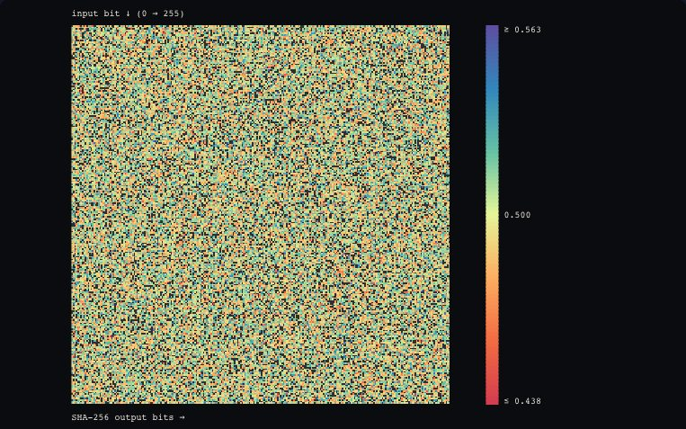</picture></a><br>
<b><a href="https://korczis.github.io/algoglyph/#/p/hash-avalanche">253 · Avalanche Matrix</a></b><br>
Flip one input bit, count which output bits flip. A good hash turns the matrix into flat grey noise at exactly one half; a weak one leaves its wiring exposed.<br>
<sub>Integrity · 1 hash pair per trial · cryptography, SHA-256, statistics</sub>
</td>
</tr>
<tr>
<td width="50%" valign="top">
<b><a href="https://korczis.github.io/algoglyph/#/p/merkle-tree">254 · Merkle tree and hash chain</a></b><br>
Hashes of hashes up to one root, and a chain in which every entry seals the one before.<br>
<sub>Integrity · O(d log n) digests to find d differing blocks of n; O(n) to audit a chain of n links · merkle tree, hash chain, tamper evidence</sub>
</td>
<td width="50%"></td>
</tr>
</table>
<!-- algoglyph:derived:end catalogue -->

## How it works

**One contract, one stage.** A plate is a `Plate` object (`src/core/plate.ts`): metadata,
parameter definitions, notes, and `create()` returning `setup()` and `draw()`. Only the stage
(`src/core/stage.ts`) turns it into a running p5 instance. The stage owns everything every
plate needs alike: canvas size from the host and aspect ratio, pixel density, pausing (by hand,
off screen through `IntersectionObserver`, and under `prefers-reduced-motion`), single
stepping, PNG export, `role="img"` with a label, the light and dark grounds, and the gallery
thumbnails. A plate draws only through the context it receives (`ctx.palette()`, `ctx.bg`,
`ctx.fg`, `ctx.rnd`, `ctx.stats()`) and never creates a canvas or picks a background itself
(rule `project.viz-component-layer`).

**Seeded, so a URL reproduces the picture.** A plate's only randomness is `ctx.rnd`, a
`mulberry32` generator seeded from the route, and the route also carries every parameter that
differs from its default (`#/p/<id>?seed=<n>&<key>=<value>`, the same for `#/lab/<id>`), each
checked against its control by `src/core/share.ts`. A copied link therefore gives the same
frames.

**Readouts are measured.** Every number a plate shows is computed from the simulation's own
state, never a constant or an estimate; physics plates use a named integrator (RK4, leapfrog,
Verlet, explicit finite differences) and report a conserved quantity or its drift where one
exists, and every claim in a plate's notes can be checked against the code or a standard
reference (rule `project.no-fake-science`).

**Tested against independent references.** The pure algorithm and integrator modules live
beside each plate and are unit tested in `test/` with Vitest, against values from an
independent source (`node:crypto`, brute force, known sequences), never from the code under
test. `test/registry.test.ts` checks the registry itself: numbering, unique ids, defaults
inside their controls.

**A browser gate in front of every merge.** `scripts/audit-ui.mjs` serves the built site in
one headless Chrome launch and, in both themes at 390 px and 1440 px, fails on any axe-core
WCAG 2.2 A/AA violation, console error, horizontal overflow, missing thumbnail, or plate that
does not mount a canvas and publish a readout (rule `project.ui-quality-gate`).

**Delivery.** Every push to `main` runs `.github/workflows/pages.yml` on the self-hosted runner
`lundra-algoglyph` (ADR 0003): the full CI (`ci.yml`), then the deploy to GitHub Pages, then
`verify.yml`, which polls the live `revision.txt` until production serves that commit. Pull
request CI stays on GitHub-hosted runners. The same steps by hand, through the gh CLI:

```sh
npm run deploy:validate   # ci.yml on the current branch
npm run deploy            # pages.yml on main: validate, deploy, verify
npm run deploy:verify     # production serves origin/main and answers
```

**Supervision.** The repository is supervised by [Majordomus](https://majordomus.dev). Its
rules, ADRs and policy live in `.ai/`. Agents start from `AGENTS.md` (Claude: `CLAUDE.md`,
Gemini: `GEMINI.md`), all three generated from `.ai/repo/policy.yaml` by `majordomus update`.
Work runs as `majordomus context`, then `majordomus start` / `check` /
`finish --verify-command "npm run verify"`; the pre-commit hook runs `majordomus doctor`.

## Development

Node 22 or later.

```sh
npm ci            # also points git at .githooks (commit-msg, pre-commit, pre-push)
npm run dev       # http://localhost:5173
npm run verify    # the CI gate, locally; --fast skips the browser gate
npm run readme    # regenerate the derived sections of this README
```

`npm run verify` (`scripts/verify-all.sh`) runs the same steps as CI in the same order and
stops at the first failure: typecheck, unit tests, README derived sections current, build,
the Flowbite Pro verifier when present, the browser gate, `majordomus doctor`.

| Layer        | Where |
|--------------|-------|
| Catalogue: entries, taxonomy, labs, sources | `catalogue/` |
| Catalogue parser, Vite plugin, CLI | `scripts/lib/catalogue.mjs`, `scripts/catalogue.mjs` |
| Plate contract, stage, palettes, RNG, catalogue model | `src/core/` |
| Engines (one family's input, drawing, measurement, lab) | `src/engines/<engine>/` |
| Kernels (one algorithm, no drawing) | `src/kernels/<engine>/<id>.ts` |
| Bespoke plates | `src/plates/<id>/` |
| Registry, discovered from the paths above | `src/registry.ts` |
| Shell (Flowbite Pro markup, Alpine state) | `index.html`, `src/main.ts`, `src/styles/` |
| Unit tests (reference values, integrator invariants) | `test/` |
| Browser gate (axe WCAG 2.2 AA, console, overflow, every plate) | `scripts/audit-ui.mjs` |
| README derived sections | `scripts/build-readme.mjs` |
| CI, Pages deploy, production verification | `.github/workflows/` |
| Supervision (rules, ADRs, policy) | `.ai/` (Majordomus) |

### Adding an algorithm

1. `npm run catalogue -- new <id> --title "<title>" --taxonomy <wing/shelf> --engine <engine>`
   writes `catalogue/entries/<id>.md` as `planned`; add `--kernel` to scaffold the kernel too.
2. For an engine that exists, write `src/kernels/<engine>/<id>.ts`: the algorithm only, through
   the engine's instrumented operations. The engine's harness test checks it against an
   independent reference on every input shape without a line of new test code.
3. For a bespoke plate, write `src/plates/<id>/plate.ts` with a default export: parameters and
   `create()` returning `setup()`/`draw()`, drawing only through the context.
4. Write the summary and reading notes in the entry's body, set `status: live`, then
   `npm run readme`, `npm run catalogue -- plan --write` and `npm run verify`.

## Provenance of this README

Every fact about the code in this file is derived, not typed:

| Section | Source | How |
|---------|--------|-----|
| Counts under the header | `catalogue/` | `scripts/build-readme.mjs` reads the catalogue through `scripts/lib/catalogue.mjs`, the parser the site is built with |
| Plate catalogue | `catalogue/` (entries and taxonomy) | the same script; headings from the taxonomy, links from `id`, previews from `docs/previews/<id>.jpg` when present |
| Everything else | authored | written by hand and reviewed against the rules in `.ai/repo/rules/project/` |

The derived regions sit between `<!-- algoglyph:derived:begin … -->` and
`<!-- algoglyph:derived:end … -->` markers. `node scripts/build-readme.mjs --check` fails when
they differ from what the catalogue would produce; `npm run verify` and CI run it, so an entry
added without regenerating the README does not merge.

## Licence

MIT, see `LICENSE`. Third-party notices are in `NOTICE.md`: p5.js is LGPL-2.1 and its
unmodified source is available at the pinned version. The page markup adapts the owner's
licensed Flowbite Pro templates; no Flowbite Pro source file is part of this repository or of
the built site.
